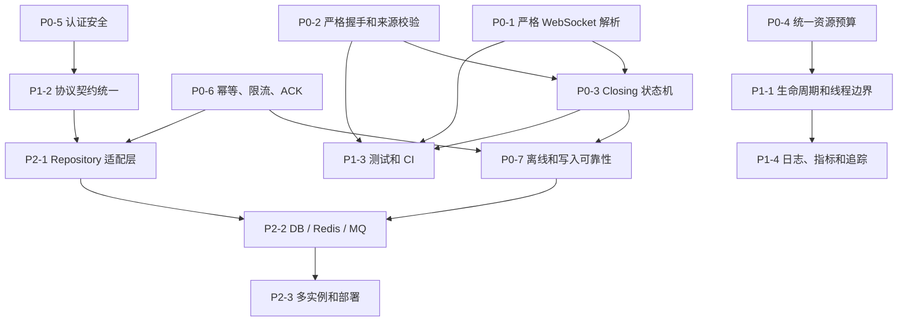

# IM 项目改进计划与技术学习路线

本文将当前项目的技术点、学习前置、代码问题和改进计划统一整理，目标是：

```text
学习型项目的实现复杂度可控，
但正确性、安全边界、测试标准和架构接口按生产系统设计。
```

本文不建议一开始直接接入所有 MySQL、Redis 和消息队列，而是先完成单进程服务的协议正确性、并发安全、消息语义和测试基线，再逐步替换为生产基础设施。

> **源码状态说明：** 本文基于当前工作区源码，全部改动已提交至 `HEAD`（截至协议 v2.0，群聊管理）。文中的行号以当前工作区为准。

## 1. 项目现状

当前项目是一个 C++17、Linux `epoll` ET、单进程的 WebSocket IM 服务端，协议版本 v2.2。**用户、消息、联系人、群均已持久化到 MySQL**（`users` / `messages` / `contacts` / `friend_requests` / `groups` / `group_members` 表）；**token、限流、幂等、在线状态（Presence）均可选存储到 Redis**（`IM_REDIS_ENABLED=1`，Redis 调用带 1 秒超时且锁外执行，宕机不阻塞主业务）。Docker Compose 一键编排（mysql + redis + imserver）可交付部署。

已经具备：

- 主从 Reactor 和非阻塞 TCP 连接，IPv6 双栈监听。
- 独立 IO 线程池和业务工作线程池。
- 手写 WebSocket HTTP Upgrade 和帧解析（严格校验）。
- Session 级别的业务串行化，PBKDF2 密码哈希，token 摘要化存储。
- 注册、登录、Token 重连、登出，登录限流（防洗表加固）。
- 单聊（account 定位）、离线消息（MySQL 状态机 + 渐进补发 + 确认）、历史、已读。
- 联系人体系（搜索/请求/同意/拒绝/删除）与三开关隐私设置。
- 群聊（v1.9）：建群/拉人/退群/列表/成员/历史/群发（单行存储 + 水位线补发）。
- 群管理（v2.0）：踢人/转让群主/解散/改名/公告。
- 在线状态（v2.1）：Presence 内存/Redis 双后端，列表接口下发 `online` 字段（批量 MGET）。
- 多端一致性（v2.2）：自发消息回显到发送者其他端、`msg.read_notify` 已读同步。
- 消息幂等去重（Redis/内存双后端）和发送限流（ZSET 滑动窗口）。
- WebSocket Ping / Pong 心跳，多端同时在线，单 IP 连接数上限。
- 离线消息 TTL 清理（超 7 天未领取后台删除，间隔可配）。
- `/health` 指标端点，统一 `LOG_*` 日志，MySQL 读写超时。
- **Nginx 反向代理接入**（v2.2 后）：`nginx/im.conf` + compose 第四服务（WebSocket
  升级/90s 超时/每 IP 50 连接）；`X-Forwarded-For` 真实 IP 信任链
  （`IM_TRUSTED_PROXIES`，未配置即忽略防伪造）；过代理 207 用例全量验证。
- 7 个 CTest 单元测试 + 205 个业务回归用例（内存/Redis 双模式）。
- 安全加固：offline_ack 上限、clientMsgId 上限、登录洗表防护、TTL 单位修复、
  Redis 级联防护（2026-09-09 / 2026-09-27 两轮审计闭环）。

尚未具备：

- 跨实例消息路由（单实例内存会话表为投递权威，Presence 上 Redis 仅为观察面）。
- 消息队列、多实例水平扩展（已明确排除，见非目标）。
- TLS、`wss://`、生产 Gateway。
- 结构化日志（JSON）、Metrics 导出、Tracing、CI。
- 模糊测试、Sanitizer（ASan/UBSan/TSan）常态构建。
- 日志轮转（单文件追加）。

## 2. 改进原则

### 2.1 先正确，再扩展

改进顺序必须是：

```text
协议正确性
  -> 并发和生命周期安全
  -> 输入限制和认证安全
  -> 测试和可观测性
  -> 持久化和多实例
```

在 WebSocket 协议错误、Close 顺序和消息 ACK 语义尚未稳定前，直接引入分布式组件会把问题扩散到更多系统。

### 2.2 学习实现与生产接口分离

开发阶段可以保留内存实现，但上层业务不应依赖具体容器：

```text
业务服务
  -> UserRepository / MessageRepository / PresenceStore
  -> Memory Adapter（当前学习实现）
  -> MySQL / Redis / MQ Adapter（生产实现）
```

### 2.3 生产标准不等于一开始部署生产基础设施

当前阶段要提前确定：

- 明确错误语义。
- 明确消息状态。
- 明确超时和资源预算。
- 明确可替换接口。
- 明确测试和验收标准。

但不强制第一阶段就部署完整的数据库集群和消息平台。

## 3. 技术点与学习前置

### 3.1 基础开发能力

| 技术点 | 必须掌握的内容 | 项目对应 |
|---|---|---|
| C++ 基础 | 语法、函数、类、继承、引用、指针、const | 所有 `.cpp` / `.hpp` |
| RAII | 构造、析构、资源所有权、异常安全 | `Connection`、`Session`、线程对象 |
| 移动语义 | move constructor、右值引用、避免拷贝 | 读写缓冲、任务队列、JSON |
| STL | `string`、`vector`、`deque`、`map`、`set` | 所有 Store 和队列 |
| 智能指针 | `shared_ptr`、`weak_ptr`、循环引用 | Session 生命周期 |
| Lambda | 捕获、回调、闭包生命周期 | EventLoop、Channel、业务回调 |
| 异常 | 异常传播、线程函数异常、异常边界 | `Session::drain()` |
| C++ 并发 | mutex、atomic、条件变量、内存模型 | ThreadPool、Store、Session |
| CMake | 编译、链接、头文件、测试目标 | `CMakeLists.txt` |
| Git | 分支、diff、提交、clean checkout | 当前工作区管理 |

如果没有系统学习过 C++，不要直接从 `websocket.cpp` 开始。应先掌握 RAII、STL、Lambda、智能指针、异常和基本并发。

### 3.2 Linux 和系统编程

| 技术点 | 必须掌握的内容 | 项目对应 |
|---|---|---|
| 进程与线程 | 地址空间、调度、线程栈、线程退出 | 主线程、IO 线程、工作线程 |
| 文件描述符 | fd、生命周期、关闭、复用 | socket、epoll、eventfd、timerfd |
| 信号 | SIGINT、SIGTERM、SIGPIPE、信号屏蔽 | `main.cpp`、`util.cpp` |
| 系统调用 | 返回值、errno、EINTR、资源失败 | 所有网络代码 |
| 调试工具 | GDB、Core Dump、Sanitizer | 后续并发和生命周期验证 |
| Shell | 构建、启动、日志重定向、进程管理 | `scripts/*.sh` |

### 3.3 TCP/IP 和 Socket

| 技术点 | 必须掌握的内容 | 项目对应 |
|---|---|---|
| TCP/IP | IP、端口、连接、三次握手、四次挥手 | `TcpServer` |
| Socket API | `socket`、`bind`、`listen`、`accept`、`recv`、`send` | `tcpserver.cpp`、`connection.cpp` |
| TCP 字节流 | 半包、粘包、没有消息边界 | `Connection` + `FrameParser` |
| 非阻塞 IO | `O_NONBLOCK`、`EAGAIN`、`EWOULDBLOCK` | `connection.cpp` |
| 部分发送 | send 可能只完成部分写入 | `flushWrite()` |
| 内核缓冲 | socket 读写缓冲、阻塞和背压 | Connection 写队列 |
| TCP 参数 | `SO_REUSEADDR`、`TCP_NODELAY`、`MSG_NOSIGNAL` | `util.cpp`、`tcpserver.cpp` |

阶段目标：能够解释为什么一次 `recv()` 不能等价于一条 WebSocket 消息，以及为什么一次 `send()` 可能只发送一部分数据。

### 3.4 HTTP/1.1 和 TLS

如果没有系统学习过 HTTP，必须先学习 HTTP，再学习 WebSocket。

| 技术点 | 必须掌握的内容 | 项目对应 |
|---|---|---|
| HTTP 报文 | 请求行、状态行、Header、Body | WebSocket 握手 |
| HTTP 方法 | GET、POST 和方法语义 | `validateHandshake()` |
| HTTP 状态码 | 101、400、403、404、426、500 | 握手和业务错误 |
| Header | 大小写不敏感、重复 Header、Token 列表 | `getHeader()` |
| HTTP/1.1 | Host、持久连接、请求路径 | `websocket.cpp` |
| Upgrade | 从 HTTP 切换到 WebSocket | `Session::handleHandshake()` |
| Host / Origin | 虚拟主机和跨站连接 | Origin / Host 校验 |
| TLS | 证书、加密、TLS 终止、`wss://` | 生产部署 |
| 代理 | Nginx、反向代理、可信 Header | Gateway 设计 |

必须理解：

```text
握手成功前，连接按 HTTP 处理。
收到 101 后，后续字节才按 WebSocket 帧处理。
```

### 3.5 WebSocket RFC 6455

| 技术点 | 必须掌握的内容 | 项目对应 |
|---|---|---|
| 握手 | Key、Magic GUID、SHA-1、Base64、Accept | `websocket.cpp:120-160` |
| 帧结构 | FIN、RSV、opcode、MASK、Payload Length | `websocket.cpp:181-231` |
| Mask | 4 字节 Mask Key 和异或还原 | `websocket.cpp:210-227` |
| 增量解析 | 半帧、多帧、游标、compact | `FrameParser` |
| 分片 | Text、Binary、Continuation、FIN | `session.cpp:252-304` |
| 控制帧 | Ping、Pong、Close、125 字节限制 | `session.cpp:252-319` |
| UTF-8 | 文本数据合法性 | 当前缺失，需要改进 |
| Close | Close code、回帧、写完关闭 | 当前存在顺序风险 |
| 协议安全 | MASK、RSV、opcode、长度和路径 | 当前需要加强 |

建议学习顺序：

```text
HTTP 报文
  -> HTTP Upgrade
  -> WebSocket 握手
  -> 帧二进制结构
  -> Mask
  -> 增量解析
  -> 分片
  -> 控制帧
  -> Session 状态机
```

### 3.6 事件驱动和并发

你已经学习过 Reactor，这里主要建立技术点与源码的映射。

| 技术点 | 项目对应 |
|---|---|
| 主从 Reactor | `TcpServer` + `EventLoopThreadPool` |
| ET 模式 | `EventLoop::run()`、读到 `EAGAIN` |
| EventLoop | `eventloop.cpp` |
| Channel | `channel.cpp` |
| eventfd | 跨线程任务投递和唤醒 |
| timerfd | 心跳定时 |
| IO 线程池 | `eventloop_threadpool.*` |
| 业务线程池 | `threadpool.*` |
| Session 串行化 | `enqueueAndDrain()` / `drain()` |
| 线程安全写回 | `Connection::send()` / `flushWrite()` |
| 对象生命周期 | `shared_ptr`、`weak_ptr`、`guard_` |
| 竞态处理 | 登录与关闭、停止与任务投递 |

重点问题：

- Session 关闭后，已排队业务任务是否仍会产生副作用？
- 工作线程池停止后，IO 线程是否仍可能提交任务？
- Close、flush 和 force close 的顺序是否安全？
- 在线表移除和登录上线是否存在竞态？
- `UserStore` 的全局锁是否包住了 PBKDF2？
- 工作线程任务队列是否可能无限增长？

### 3.7 数据结构和业务协议

| 技术点 | 必须掌握的内容 | 项目对应 |
|---|---|---|
| JSON | 序列化、反序列化、类型检查 | `message.cpp` |
| Envelope | `type`、`data`、`seq`、`ts` | `docs/protocol.md` |
| Schema | 字段、类型、长度、范围 | 当前需要增强 |
| 错误设计 | 协议错误和业务错误分离 | `makeError()`、`makeResult()` |
| 版本兼容 | 未知字段、版本号、迁移 | 协议文档 |
| 状态机 | 未登录、已登录、登出、重连 | `AppServer`、`Session` |
| 多端在线 | 一个用户多个 Session | `OnlineManager` |
| 离线消息 | 队列、容量、补发、删除 | `OfflineStore` |
| 幂等 | `clientMsgId`、请求指纹、重复请求 | `MsgDedup` |
| 限流 | 时间窗口、用户/IP/接口维度 | `RateLimiter` |
| ACK | accepted、queued、delivered、read | 当前需要重新定义 |

### 3.8 认证和安全

| 技术点 | 必须掌握的内容 | 项目对应 |
|---|---|---|
| 密码存储 | 盐、慢哈希、PBKDF2、Argon2id | `user_store.cpp` |
| HMAC | 密钥摘要和完整性 | `util.cpp` |
| CSPRNG | 安全随机数和 Token | 当前需要改进 |
| Token | 过期、撤销、轮换、防重放 | `UserStore` |
| TLS | 证书、加密、`wss://` | 当前未实现 |
| Origin | 浏览器跨站 WebSocket | `session.cpp` |
| 输入安全 | 长度、UTF-8、类型、范围 | 当前需要增强 |
| DoS 防护 | 连接、握手、队列、消息、认证限流 | 当前部分实现 |
| 日志脱敏 | 密码、Token、消息内容保护 | 当前部分实现 |

### 3.9 可靠性和消息语义

| 技术点 | 必须掌握的内容 | 当前问题 |
|---|---|---|
| 优雅关闭 | 停止接收、排空任务、关闭连接 | 基础已实现，需要状态机 |
| 超时 | 握手、写入、心跳、关闭 deadline | 握手（10s）与心跳已实现；写入/关闭 deadline 待补 |
| 背压 | 慢客户端、队列上限、反馈 | 有上限，反馈不足 |
| 重试 | 网络、消息、消费者重试 | 当前无持久化重试 |
| 幂等 | 重试不造成重复投递 | 当前顺序有问题 |
| 持久化 | 账号、消息、离线状态 | 账号已落 MySQL（users 表）；消息、离线、token 仍为内存 |
| 故障恢复 | 重启、崩溃、依赖故障 | 当前不支持 |
| 消息语义 | 至多一次、至少一次 | ACK 语义过宽 |

核心原则：

```text
ACK 只能确认已经完成的事情。
内存入队不能伪装成持久化。
写入队列不能伪装成对方已收到。
```

### 3.10 数据库、Redis 和分布式系统

| 技术点 | 必须掌握的内容 | 未来用途 |
|---|---|---|
| SQL | 表、索引、事务、隔离级别 | 用户和消息持久化 |
| Redis | TTL、原子操作、Lua、Stream | Token、Presence、限流、幂等 |
| 消息队列 | 分区、消费组、ACK、重试、死信 | 跨实例投递 |
| Outbox | 数据库和消息发布一致性 | 可靠发送 |
| Presence | 用户在哪个 Gateway 在线 | 多实例路由 |
| 一致性 | 重复、乱序、丢失、最终一致 | IM 消息语义 |
| 水平扩展 | Gateway、负载均衡、连接归属 | 多实例 WebSocket |

### 3.11 测试和工程工具

| 技术点 | 学习内容 | 改进目标 |
|---|---|---|
| 单元测试 | Parser、Store、Limiter、状态机 | 当前缺少 |
| 集成测试 | 建连、登录、单聊、离线 | 现有脚本纳入 CTest |
| 协议负向测试 | 非法帧、握手、JSON | 当前缺少 |
| 模糊测试 | 随机帧、Header、边界长度 | 当前缺少 |
| ASan | UAF、越界、double free | 当前未启用 |
| TSan | 数据竞争 | 当前未启用 |
| UBSan | 未定义行为 | 当前未启用 |
| 压力测试 | 连接数、吞吐、延迟、慢客户端 | 当前缺少 |
| CI | clean checkout、构建、测试、静态检查 | 当前缺少 |
| CMake | CTest、测试目标、编译选项 | 当前缺少 |

推荐工具：Wireshark、`websocat`、Python `websocket-client`、GDB、`strace`、`ss`、`lsof`、`perf`、AddressSanitizer、ThreadSanitizer 和 `clang-tidy`。

## 4. 分阶段学习路线

### 阶段 0：开发工具和 Linux 基础

学习内容：

- Shell、文件、进程和权限。
- Git 分支、diff、提交和 clean checkout。
- CMake 配置、编译、链接和构建目录。
- GDB、日志、Core Dump。
- AddressSanitizer 和 ThreadSanitizer。

对应项目：`CMakeLists.txt`、`scripts/`、`src/main.cpp`。

验收标准：

- 能从 clean checkout 配置并构建项目。
- 能使用 GDB 查看主线程、IO 线程和工作线程。
- 能定位一个连接的 fd 和对应日志。

### 阶段 1：C++17

学习内容：

- 类、引用、指针、const、继承。
- RAII、析构、移动语义和异常安全。
- STL 容器和迭代器。
- Lambda、`std::function`、回调。
- `shared_ptr`、`weak_ptr` 和循环引用。
- mutex、atomic、条件变量和线程安全。

对应项目：`Connection`、`Session`、`ThreadPool`、`OnlineManager`。

验收标准：

- 能说明 `Session` 为什么需要 `guard_`。
- 能说明 OnlineManager 为什么使用 `weak_ptr`。
- 能说明 `writeMutex_` 和 `writeBufferedBytes_` 分别解决什么问题。

### 阶段 2：TCP/IP 和 Socket

学习内容：

- TCP 字节流。
- Socket 生命周期。
- 阻塞和非阻塞。
- `EAGAIN`、`EINTR`。
- 部分发送和写缓冲。
- 慢客户端和背压。

对应项目：`src/tcpserver.*`、`src/connection.*`。

实验：将一条 WebSocket 帧拆成多个 TCP 写入，并观察 Parser 如何等待完整数据。

### 阶段 3：HTTP/1.1 和 TLS

学习内容：

- 请求行、Header、状态码。
- Header 大小写不敏感和 Token 列表。
- Host、Origin、代理和反向代理。
- HTTP Upgrade。
- TLS 证书和 `wss://`。

对应项目：`src/websocket.*`、`src/session.cpp:215-250`。

验收标准：

- 能手工解释一次 HTTP 101 响应。
- 能说明 Origin 和 Host 校验的区别。
- 能说明 TLS 在 Gateway 终止和进程内终止的差异。

### 阶段 4：WebSocket RFC 6455

学习内容：

- 握手 Accept。
- FIN、RSV、opcode、MASK。
- Payload 长度编码。
- 增量解析和游标压缩。
- Text、Binary、Continuation。
- Ping、Pong、Close。
- UTF-8 和协议错误。

对应项目：`src/websocket.cpp:120-252`、`src/session.cpp:252-334`。

实验：

- 手工计算 `Sec-WebSocket-Accept`。
- 构造短帧、126 字节 Payload 和大 Payload。
- 发送未 Mask、RSV 非零和非法 opcode。
- 发送 Text 分片、Ping、Pong 和 Close。

### 阶段 5：Session、线程池和生命周期

学习内容：

- Session 状态机。
- IO 线程和工作线程边界。
- 同一个 Session 串行化。
- 跨线程 reply。
- 关闭竞态和对象生命周期。
- 心跳定时器。

对应项目：`src/session.*`、`src/eventloop.*`、`src/threadpool.*`。

验收标准：

- 能画出一次消息从 `recv()` 到 `reply()` 的线程切换图。
- 能解释关闭时为什么不能直接销毁 Connection。
- 能使用 TSan 验证 Session 和 Connection 竞态。

### 阶段 6：JSON 协议和 IM 业务

学习内容：

- JSON 类型校验和 schema。
- 请求、事件和错误响应。
- 注册、登录、Token 重连。
- 多端在线、离线消息和补发。
- 幂等、限流和 ACK。

对应项目：`src/message.*`、`src/appserver.*`、`src/*_store.*`、`docs/protocol.md`。

验收标准：

- 能解释 `msg.ack` 的边界。
- 能发现幂等记录早于限流的问题。
- 能为离线消息设计 pending/inflight/ack/retry 状态。

### 阶段 7：安全、测试和可观测性

学习内容：

- 密码慢哈希和 CSPRNG。
- TLS 和 Origin 安全。
- 输入预算和 DoS 防护。
- 单元测试、集成测试、模糊测试。
- ASan、TSan、UBSan。
- 结构化日志、Metrics、Tracing。

对应项目：`src/user_store.*`、`src/util.*`、`scripts/`、`CMakeLists.txt`。

### 阶段 8：SQL、Redis、消息队列和生产部署

学习内容：

- SQL 事务和索引。
- Redis TTL、原子操作和 Stream。
- MQ 消费、重试、死信和幂等。
- Outbox Pattern。
- 多实例 Gateway 和 Presence。
- Docker、systemd、Nginx、CI/CD。

这一阶段建立在前面消息状态、ACK 和错误语义已经稳定的基础上。

## 5. 改进计划总览

**当前状态（2026-09-16）：** ✅ 已完成 / ◐ 部分完成 / ○ 未开始。

| 项 | 状态 | 说明 |
|---|---|---|
| P0-1 严格 WebSocket 解析 | ✅ | v1.4 完成，含 parser/handshake 单测 |
| P0-2 严格握手和来源校验 | ✅ | v1.4 完成（请求行/Host/Key/Origin） |
| P0-3 Closing 状态机 | ✅ | 写完关闭 + 5 秒 deadline |
| P0-4 统一资源预算 | ✅ | `server_config.hpp` 集中常量 |
| P0-5 认证安全 | ✅ | PBKDF2 + token 摘要 + 登录限流（含洗表加固） |
| P0-6 幂等、限流、ACK | ✅ | 双后端（内存/Redis），顺序修正 |
| P0-7 离线和写入可靠性 | ✅ | MySQL 状态机 + 非破坏性补发 + offline_ack + TTL 清理（v2.1） |
| P1-1 生命周期和线程边界 | ✅ | 优雅关闭/停止顺序已做；TSan 全链路通过（修复 2 处 EventLoopThread 线程身份发布竞争，2026-09-27） |
| P1-2 协议契约统一 | ✅ | v1.3-v2.0 统一 envelope，字段校验齐全 |
| P1-3 测试和 CI | ◐ | 7 单测 + 205 biz 双模式；CI/模糊/Sanitizer 未做 |
| P1-4 日志、指标和追踪 | ◐ | LOG_* + /health 指标；结构化/导出/告警未做 |
| P2-1 Repository 适配层 | ✅ | User/Message/Contact/Group 四仓库接口 |
| P2-2 DB / Redis / MQ | ◐ | MySQL 全量 + Redis 可选（含 Presence/超时/锁外化，v2.1-v2.2 加固）；MQ 未做 |
| P2-3 多实例和部署 | ◐ | Docker 单机交付；多实例/Presence 共享未做 |



## 6. P0：正确性与安全基线

### P0-1：严格 WebSocket 帧解析

**问题：** 当前 `FrameParser::parseOne()` 只返回 `bool`，无法区分需要更多数据和协议错误；未强制 MASK，未完整校验 RSV、opcode、UTF-8、Close code 和长度编码。

**源码范围：**

- 修改：`src/websocket.hpp`、`src/websocket.cpp`
- 修改：`src/session.hpp`、`src/session.cpp`
- 新增测试：`tests/websocket_parser_test.cpp`

**计划：**

- 引入 `NeedMore`、`Complete`、`ProtocolError` 三态结果。
- 校验客户端帧必须 Mask。
- 校验 RSV、opcode、64 位长度最高位和最小长度编码。
- 校验控制帧必须 FIN 且 Payload 不超过 125 字节。
- 校验 Text 和 Close Payload 的 UTF-8。
- 校验 Close code。
- 保留单帧、单消息、累计缓冲的配置上限。

**验收：** 合法帧、半帧、多帧、未 Mask、非法 RSV、非法 opcode、非法长度、控制帧分片、非法 UTF-8、非法 Close code 和超限帧均有确定结果。

### P0-2：严格 HTTP 握手和来源校验

**源码范围：** `src/websocket.*`、`src/session.cpp`、`src/main.cpp`、`docs/protocol.md`、`docs/client_api.md`。

**计划：**

- Header 名统一大小写不敏感。
- 校验 HTTP/1.1、Host、请求路径和 Key 格式。
- Origin 按 scheme、host、port 精确比较。
- 浏览器入口和原生客户端入口使用不同策略。
- 生产默认 fail-closed，开发放宽必须显式配置。

**验收：** 大小写 Header、缺失 Host、非法 Key、错误路径、重复 Header、错误 Origin、缺失 Origin 和代理 Header 测试全部有明确结果。

### P0-3：Closing 状态机和写完关闭

**源码范围：** `src/session.*`、`src/connection.*`、`src/eventloop.cpp`。

**计划：**

```text
Open
  -> ClosingAfterFlush
  -> Closed
```

- `send()` 返回入队结果。
- Close、握手拒绝和协议错误统一使用写完关闭。
- 增加 flush 完成回调。
- 增加关闭 deadline。
- 关闭入口全部幂等。
- 关闭后禁止新的业务副作用。

**验收：** 慢客户端、EAGAIN、双方同时 Close、协议错误和握手拒绝都能按 deadline 完成关闭，不出现 UAF 和丢失状态清理。

### P0-4：集中资源预算

**源码范围：** `src/main.cpp`、`src/tcpserver.*`、`src/connection.*`、`src/session.*`、`src/threadpool.*`、`src/appserver.*`。

**计划：** 新增 `src/server_config.hpp`，集中管理：

- 最大连接数和每 IP 连接数。
- 握手 Header 大小和 deadline。
- 单帧、单消息、读队列、写队列上限。
- 工作任务总数。
- 用户名、密码、Token、Message ID 长度。
- 全局离线消息和幂等记录预算。

**验收：** 所有限制在启动时校验，超限有明确日志、错误码和关闭原因，不再依赖匿名命名空间中的分散常量。

### P0-5：认证安全

**源码范围：** `src/util.*`、`src/user_store.*`、`src/main.cpp`、认证文档。

**计划：**

- 使用 OS CSPRNG 生成 Token 和盐。
- Token 至少使用 256 位随机材料。
- 内存和持久化层只保存 Token 摘要。
- 密码摘要带算法版本和参数。
- 旧密码摘要支持渐进迁移。
- 密码哈希移出 `UserStore` 全局锁。
- 登录失败按 IP、用户名和接口分层限流。
- 明确 TLS 在进程内还是 Gateway 终止。

**验收：** 密码学测试向量、Token 重复率、Token 过期/撤销、TLS 负向测试和认证压力测试通过。

### P0-6：幂等、限流和 ACK

**源码范围：** `src/appserver.cpp`、`src/msg_dedup.*`、`src/rate_limiter.*`、`src/message.*`、协议文档。

**计划：** 消息处理改为：

```text
参数校验
  -> 限流预检查
  -> 请求指纹计算
  -> 幂等查询
  -> 在线投递或离线入队
  -> 记录状态
  -> 返回准确 ACK
```

幂等记录至少保存：

```text
senderId、clientMsgId、requestFingerprint、messageId、status、expireAt
```

相同 ID 但请求内容不同必须返回冲突。

ACK 分层：

| 状态 | 含义 |
|---|---|
| accepted | 服务端接受请求 |
| queued | 已进入离线或跨实例队列 |
| delivered | 已进入目标连接写队列 |
| read | 客户端明确上报已读 |

### P0-7：离线和写入可靠性

**源码范围：** `src/offline_store.*`、`src/appserver.cpp`、`src/connection.*`。

**计划：**

- 离线消息从 destructive take 改为 pending / inflight / ack / retry / expiry。
- `Connection::send()` 不再静默丢弃结果。
- 写缓冲超限时向业务层返回失败原因。
- 明确在线投递和离线入队的 ACK 边界。
- 所有消息使用全局 Message ID。

**验收：** 登录补发中断、慢客户端、服务重启、重复补发和连接关闭竞态均不会产生无记录的成功 ACK。

## 7. P1：测试、可观测性和单机可靠性

### P1-1：生命周期和线程边界

**源码范围：** `src/session.*`、`src/connection.*`、`src/threadpool.*`、`src/eventloop_thread.*`、`src/appserver.cpp`。

**计划：**

- 明确 Open、Closing、Closed 状态。
- 关闭后取消或拒绝业务任务。
- 规范停止顺序：停止接收、停止提交、排空任务、关闭连接、停止 loop。
- 初始化完成后再发布 EventLoop 线程身份。
- 所有异步回调幂等。
- 用 TSan 检查登录、关闭、在线表和停止竞态。

### P1-2：协议契约统一

**源码范围：** `src/message.*`、`src/appserver.*`、`docs/protocol.md`、`docs/client_api.md`、客户端和测试脚本。

**计划：**

- 选择唯一协议版本。
- 统一 `auth.token`、`heartbeat`、`chatType` 和 ACK 语义。
- 增加字段级 schema、长度和范围校验。
- 统一错误事件和业务响应格式。
- 更新旧客户端，使其发送 JSON envelope。
- 增加协议契约测试，客户端和服务端共享测试样例。

### P1-3：测试和 CI

**新增或修改：**

- `tests/websocket_parser_test.cpp`
- `tests/websocket_handshake_test.cpp`
- `tests/connection_close_test.cpp`
- `tests/message_delivery_test.cpp`
- `tests/resource_limit_test.cpp`
- `CMakeLists.txt`
- `.github/workflows/ci.yml` 或对应 CI 配置

**计划：**

- 启用 `enable_testing()` 和 `add_test()`。
- Parser、Store、Limiter、状态机做单元测试。
- 建连、登录、单聊、离线和重连做集成测试。
- 增加非法帧、非法握手、非法 JSON 负向测试。
- 增加模糊测试和边界长度测试。
- 提供 ASan、UBSan、TSan 构建配置。
- CI 从 clean checkout 完成配置、构建、测试和静态检查。
- 替换固定 `sleep` 为服务 ready 探测和随机端口。

### P1-4：可观测性

**源码范围：** 日志相关源文件、`src/server_config.hpp`、部署文档。

**计划：**

- 结构化日志字段：时间、级别、连接 ID、用户 ID、Message ID、线程 ID、关闭原因。
- 密码、Token 和消息正文全部脱敏。
- 增加连接数、握手失败、协议错误、Close 原因、队列长度、写缓冲、事件循环延迟、认证失败、限流和投递状态指标。
- 增加健康检查和就绪检查。
- 增加慢客户端和工作线程积压告警。

## 8. P2：生产基础设施和分布式演进

### P2-1：Repository 和 Adapter 边界

新增接口层：

```text
UserRepository
MessageRepository
PresenceStore
TokenStore
IdempotencyStore
RateLimitStore
DeliveryQueue
```

当前实现提供 Memory Adapter，后续实现：

```text
MySQL / PostgreSQL Adapter
Redis Adapter
Message Queue Adapter
```

业务层只依赖接口，不直接依赖 `unordered_map`、`deque` 或具体 Redis 客户端。

### P2-2：持久化和共享状态

| 数据 | 推荐实现 | 状态 |
|---|---|---|
| 用户账号和密码摘要 | MySQL / PostgreSQL | ✅ 已接入 MySQL（users 表） |
| 消息和离线状态 | MySQL / PostgreSQL 或可靠消息存储 | 未开始 |
| Token | Redis 或数据库 | 未开始（当前内存） |
| 在线 Presence | Redis | 未开始（当前内存） |
| 限流 | Redis | 未开始（当前内存） |
| 幂等 | Redis 或数据库 | 未开始（当前内存） |
| 跨实例投递 | Kafka、RabbitMQ、Redis Stream 等 | 未开始 |

### P2-3：多实例消息路由

```text
客户端
  -> Load Balancer / TLS Gateway
  -> Gateway 1
  -> Message Store
  -> Message Queue
  -> Gateway 2
  -> 目标用户连接
```

关键原则：

```text
连接是本地资源，消息路由必须是分布式的。
```

需要设计：

- 用户在哪个 Gateway 在线。
- Gateway 如何订阅目标用户消息。
- 消息重复消费如何幂等。
- 目标 Gateway 宕机如何重试。
- 离线消息何时转入持久化。
- ACK 处于哪个状态时可以返回客户端。

### P2-4：部署和安全

- 使用 `wss://`。
- Nginx、Envoy 或专用 Gateway 终止 TLS。
- 服务以非 root 用户运行。
- 使用环境变量或密钥管理系统注入配置。
- 增加 Docker、systemd 或 Kubernetes 部署定义。
- 增加依赖漏洞扫描和镜像扫描。
- 增加滚动发布、优雅下线和 readiness 管理。

## 9. 执行顺序

### 里程碑 M0：建立基线 ✅

- [x] 确认工作区改动与 `HEAD` 的边界。
- [x] 从 clean checkout 配置并构建。
- [x] 记录当前协议行为和现有测试结果。
- [x] 固定协议版本和当前已知不一致项。
- [x] 建立 `tests/` 和 CTest 基础结构。

### 里程碑 M1：WebSocket 正确性 ✅

- [x] 完成 Parser 三态结果。
- [x] 完成 MASK、RSV、opcode、长度编码校验。
- [x] 完成 UTF-8 和 Close code 校验。
- [x] 完成握手 Header、Host、Path、Origin 校验。
- [x] 完成协议正向和负向测试。

### 里程碑 M2：连接关闭和资源安全 ✅

- [x] 引入 Closing 状态。
- [x] 实现写完关闭和关闭 deadline。
- [x] 统一握手拒绝、协议错误和 Close 路径。
- [x] 集中配置所有输入和队列限制。
- [x] 完成慢客户端、Slowloris 和超大输入测试。

### 里程碑 M3：认证和消息语义 ✅

- [x] 使用 CSPRNG 和成熟密码学实现。
- [x] 明确 Token 摘要、过期、撤销和轮换。
- [x] 修正幂等早于限流的问题。
- [x] 增加请求指纹和 Message ID。
- [x] 定义 accepted、queued、delivered、read。
- [x] 将离线消息改为可重试状态机。

### 里程碑 M4：单机生产基线 ◐

- [x] 完成 Session 生命周期和线程边界治理。
- [x] 完成单元、集成、负向测试（7 单测 + 188 biz）。
- [x] 启用 ASan、UBSan、TSan（2026-09-27 全链路零报告；CMake `IM_SANITIZE`/`IM_TSAN` 选项）。
- [x] 增加结构化日志和核心指标（LOG_* + /health）。
- [ ] 增加 CI、配置校验和 clean checkout 构建。
- [ ] 增加 TLS Gateway 部署文档。

### 里程碑 M5：可替换基础设施 ◐

- [x] 定义 Repository 和 Adapter 接口。
- [ ] 保留内存 Adapter 作为开发实现（MySQL 为唯一用户/消息后端）。
- [x] 实现数据库用户和消息存储。
- [x] 实现 Redis Token、限流和幂等（可切换）。
- [x] 实现 Redis Presence 共享——**未做**，Presence 仍单实例内存。
- [ ] 实现 MQ 跨实例投递。
- [ ] 完成双实例故障和重复消费测试。

### 后续排期建议（2026-09-27 更新：两轮审计闭环后）

已完成（不再排期）：离线 TTL 清理（含 168 秒单位 bug 修复）、Presence 双后端 + online 字段、
多端回显与已读同步、Redis 超时/锁外化/批量 MGET、A 区打磨六项（removeMember 校验、
MySQL 超时、弱断言、迁移幂等、清理告警、heartbeat 文档）。

已完成追加（2026-09-29 第三轮）：消息保留期清理（`IM_MSG_RETENTION_DAYS`，默认 90 天，
已消费消息含群消息归档删除，TDD 209→210 用例）；重查询限流（chat/group.history 与
group.members 共享额度桶 20 次/10s，Redis 键前缀 qrate: 独立）；性能压测基线
（`scripts/bench.py`：2000 连接全保持、建连 1300+/s、RSS 23MB、吞吐 43 msg/s
受单用户限流口径、p50 25ms/p99 37ms，数字入 README 规模节）。

已完成追加（2026-09-27/28 第二轮）：B 区三项全部落地（Sanitizer 首跑修 2 处线程身份竞态、
日志轮转 50MB×5、CI 本地一键 + GitHub Actions 工作流）；D 区三项（client/ 与本文档入库、
README、read_notify 收紧 fail-closed）；A 区六项打磨；clean checkout 构建验证通过；
**Nginx 反向代理落地**（真实 IP 信任链 + 207 用例过代理全量验证，见
`docs/nginx-deploy.md`）；**Windows 客户端已按设计文档实现**（Qt6，含重连拉 history
对齐多端视图）。

下一步（2026-09-28 更新，按价值排序）：

1. **推送 GitHub**：仓库当前无 remote；推送后 `.github/workflows/ci.yml` 生效，
   项目对外可访问（唯一待办）
2. **端到端联调**（可选）：Windows 客户端 ↔ 本服务端经 Nginx（wss）实测一轮，
   将联调问题回馈协议文档
3. **多端消息漫游：明确不做**（2026-09-28 决策）：等同微信登录时"同步聊天记录"
   选项的漫游机制；本项目保持"不勾选"模式——离线端重登后由客户端拉
   `chat.history` / `group.history` 对齐视图（服务端全量可查），见 §11.3
4. **C 区性能预留**（规模到了再做）：MySQL 连接池、群发 setWatermark 批量合并、
   仓库层 shared_mutex
5. **保持现状的已知取舍**：多端离线自发消息不补发（漫游已定为非目标，history 自愈）、
   群管理事件离线不补发（拉列表自愈）、公告 2048 截断（正道不可达）、
   INCR/EXPIRE 微秒窗口（TTL 兜底）

## 10. 阶段验收标准

### 协议验收

- 非法 WebSocket 帧得到明确协议错误，不会静默占用连接。
- 客户端未 Mask、RSV 非零、非法 opcode、非法控制帧均被拒绝。
- 分片、Ping、Pong、Close 和大 Payload 行为符合协议。
- HTTP Header、Origin、Host 和路径策略有明确文档和测试。

### 并发验收

- TSan 无数据竞争。
- ASan 无 UAF、越界和 double free。
- 关闭期间不再产生新的业务副作用。
- 同一个 Session 保证顺序，不同 Session 保持并行。
- 优雅关闭可以在 deadline 内完成。

### 消息验收

- 限流失败不会污染幂等记录。
- 相同 Message ID 重试不会重复投递。
- 相同 Client Message ID 携带不同内容会冲突。
- ACK 不会把发送失败、丢失或未持久化伪装成成功。
- 离线消息补发失败可以重试或进入死信状态。

### 工程验收

- clean checkout 可以配置、构建和运行测试。
- CTest 可以执行核心单元和集成测试。
- 日志包含连接 ID、用户 ID、Message ID 和关闭原因。
- 关键资源有指标和告警。
- 部署边界明确，默认使用 TLS 和非 root 用户。

## 11. 推荐源码阅读顺序

如果从 WebSocket 开始：

1. `src/websocket.hpp`
2. `src/websocket.cpp`（帧解析与握手）
3. `src/session.hpp`
4. `src/session.cpp`（握手/心跳/队列/消息边界）
5. `src/connection.cpp`（读写与背压）
6. `src/message.*`（协议封包）
7. `src/appserver.cpp`（onEnvelope 路由总入口）
8. `src/app_auth.cpp` / `src/app_message.cpp`（认证与消息域）
9. `src/app_contact.cpp` / `src/app_group.cpp`（联系人与群域）
10. `src/app_util.hpp`（账号校验/目标解析）
11. `src/user_store.*`（注册/登录/token/限流）
12. `src/online_manager.*`（Presence）
13. `src/mysql_message_repository.*`（消息状态机与群消息）
14. `src/contact_repository.*` / `src/group_repository.*`（联系人与群存储）
15. `src/msg_dedup.*` / `src/rate_limiter_store.*`（幂等与限流，双后端）
16. `src/redis_client.*`（Redis 适配）
17. `docs/protocol.md`
18. `scripts/biz_test.py`

如果没有 C++ 或 HTTP 基础，应先按第 4 节学习路线补齐前置知识，再按以上源码顺序阅读。

## 12. 实验清单

1. 从源码计算一次 `Sec-WebSocket-Accept`。
2. 将一个 WebSocket 帧拆成多个 TCP 写入。
3. 一次发送多个 WebSocket 帧。
4. 发送未 Mask、RSV 非零和非法 opcode。
5. 发送 Text + Continuation 分片。
6. 发送 Ping、Pong 和 Close。
7. 使用慢客户端触发 8 MB 写队列限制。
8. 发送超长 Header、超长密码和超长 Message ID。
9. 重复发送相同 `clientMsgId`。
10. 相同 ID 发送不同内容。
11. 在离线补发过程中关闭连接。
12. 使用 TSan 反复并发登录、关闭和发送。
13. 使用 Wireshark 查看握手和帧。
14. 使用 `strace` 查看 `epoll_wait`、`recv`、`send` 和 `eventfd`。
15. 使用 `perf` 分析 PBKDF2、JSON 和锁竞争。

## 13. 风险与控制

| 风险 | 控制措施 |
|---|---|
| 严格协议校验影响旧客户端 | 先增加兼容性测试，再按协议版本迁移 |
| 写完关闭造成连接占用 | 写缓冲上限加关闭 deadline |
| 至少一次投递产生重复消息 | Message ID、请求指纹和消费者幂等 |
| 密码算法切换影响已有账号 | 摘要版本化和登录时渐进迁移 |
| 限流误伤 NAT 用户 | IP、用户和接口分层阈值 |
| 引入 DB/Redis 过早扩大范围 | P0/P1 完成后再实现 Adapter |
| 日志增加隐私和成本 | 统一脱敏、级别和采样策略 |
| 多线程改造引入竞态 | 每阶段运行 TSan、ASan 和关闭压力测试 |

## 14. 最终目标

项目最终应形成以下能力闭环：

```text
前置知识
  -> 协议理解
  -> 源码阅读
  -> 单元 / 集成测试
  -> 协议和并发修复
  -> 单机生产基线
  -> 可替换存储接口
  -> 持久化和分布式演进
```

完成这条路线后，应能够独立回答：

1. C++ 的所有权模型如何保证 Connection 和 Session 生命周期？
2. TCP 字节如何恢复成 WebSocket 帧？
3. WebSocket 帧如何恢复成完整业务消息？
4. 为什么 WebSocket 解析放在工作线程而不是 IO 线程？
5. 如何保证同一个 Session 的消息顺序？
6. 如何实现安全的 Close-after-flush？
7. 为什么 ACK 不等于对方已收到？
8. 如何设计可重试且幂等的离线消息？
9. 如何使用 Sanitizer、Wireshark、GDB 和 `strace` 验证系统行为？
10. 如何在不改变上层协议的情况下，将内存 Store 替换为数据库、Redis 和消息队列？
