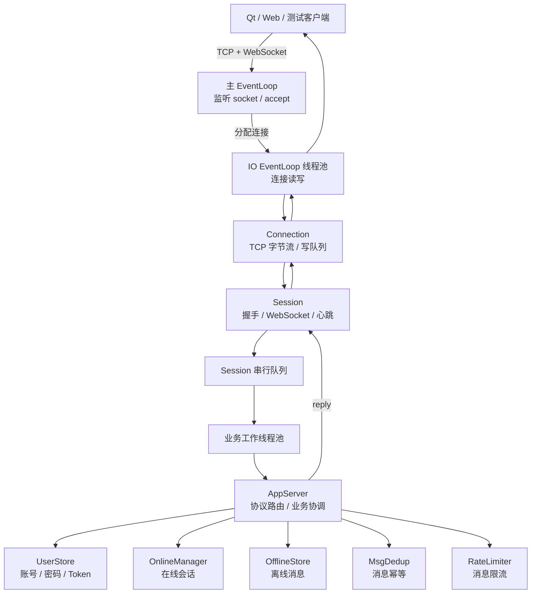
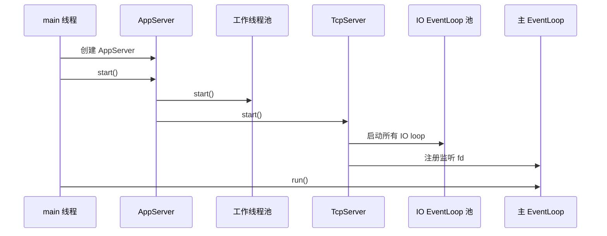
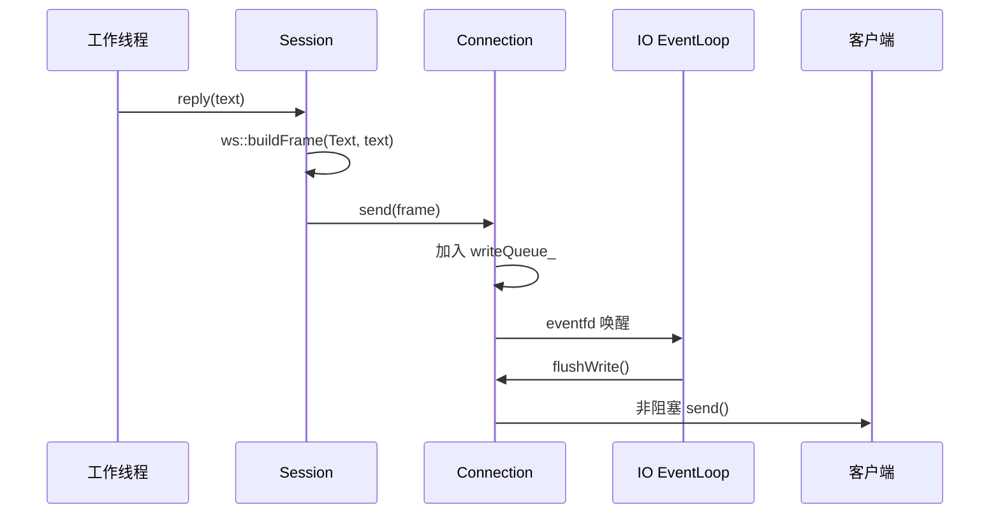
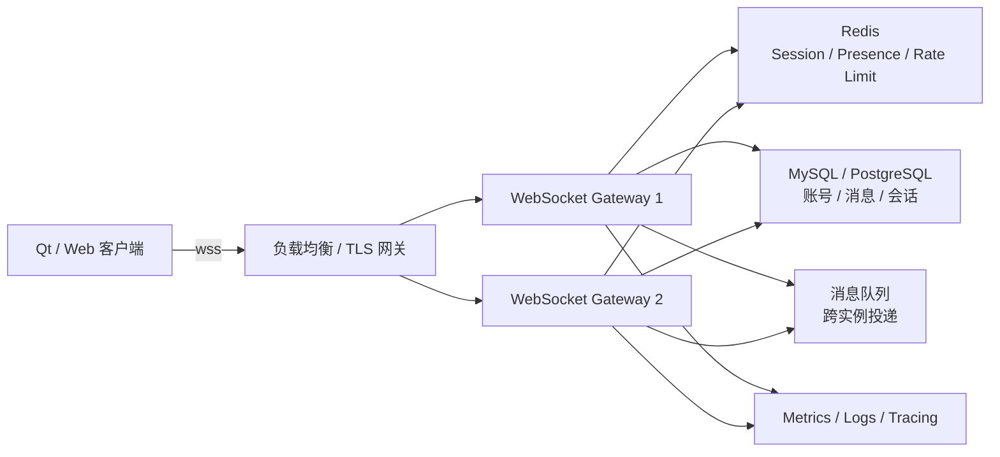

# IM 服务端架构与技术学习路线

本文基于当前工作区源码整理，面向已经学习过 Reactor、希望深入 WebSocket、并发模型和生产化架构的读者。

> **源码状态说明：** 文中的源码行号以当前工作区为准。所述能力（Origin / Host 校验、PBKDF2-HMAC-SHA256、消息限流、协议文档与测试脚本等）均已随版本提交至 `HEAD`（截至 v2.2，多端一致性）。

## 1. 项目定位

当前项目是一个单进程的 C++17 WebSocket IM 服务端，主要用于学习 Linux 网络编程、WebSocket 协议、线程池和 IM 业务建模。**用户账号与消息已持久化到 MySQL**（`users` / `messages` 表：登录账号 `account` 为 10-11 位数字、`username` 为昵称、PBKDF2 密码哈希；消息含 offline/delivered/read 状态机，超 7 天未领取的离线消息由后台 TTL 线程清理）；**token、发送限流、消息幂等、在线状态（Presence）均可选存储到 Redis**（`IM_REDIS_ENABLED=1`，重启后免密重连不失效、在线状态可外部观察，未启用则全内存）。

当前已经具备的能力：

- Linux `epoll` ET 非阻塞网络模型；IPv6/IPv4 双栈监听。
- 主从 Reactor：主线程负责 `accept`，IO 线程负责连接读写。
- 独立的业务工作线程池 + Session 级串行化。
- 手写 WebSocket HTTP Upgrade 和帧解析（三态结果、强制 MASK、RSV/opcode/UTF-8/Close code/最小长度编码严格校验）。
- 注册、登录、Token 重连（Redis 可选）、登出；账号 10-11 位数字规则。
- 单聊在线投递、**消息/离线/历史/已读 MySQL 持久化**（重启不丢）、非破坏性离线补发 + `msg.offline_ack` 确认、`chat.history`、`msg.read`。
- **联系人体系（v1.8）**：好友请求状态机（`contact.request/accept/reject`）、联系人列表（`contact.list`）、删除联系人（`contact.delete`）、在线推送 + 离线登录补发；**用户搜索**（`user.search`，受 `searchable` 控制）；**隐私设置三开关**（`settings.get/set`，`allowTempChat/searchable/allowAdd`，默认全开）；`msg.send` 发送权限校验（自己/联系人/临时对话）。
- 消息幂等去重（限流后记录）和发送限流；登录失败限制。
- 写完关闭（优雅关闭 + deadline）、写缓冲背压。
- Ping / Pong 心跳和空闲连接清理；多端同时在线。
- `/health` HTTP 指标端点（连接数/协议错误/认证失败/限流/投递等）。
- CTest 单元测试 + ASan/UBSan 构建 + Docker compose 编排（mysql+redis+imserver）。

当前没有实现的生产能力：

- 多实例消息路由（Presence 仍在单进程内存）。
- TLS、`wss://`、Nginx 或专用 WebSocket Gateway。
- 结构化日志（当前裸 `cout/cerr`）、Tracing。
- CI/CD 与正式发布配置。

最重要的整体数据流是：

```text
TCP 字节流
  -> HTTP WebSocket Upgrade
  -> WebSocket 帧
  -> 分片重组
  -> Session 状态机
  -> JSON envelope
  -> AppServer 业务路由
  -> MySQL 消息持久化（先落库成功再 ACK）
  -> 在线投递 / 离线补发（pending -> delivered -> read 状态机）
  -> WebSocket 帧
  -> 非阻塞写回
```

## 2. 目录与模块

| 模块 | 主要职责 | 关键文件 |
|---|---|---|
| 启动层 | 参数解析、信号处理、环境变量（IM_MYSQL_*/IM_REDIS_*）、启动和关闭 | `src/main.cpp` |
| 网络层 | socket、**IPv6/IPv4 双栈监听**、accept、连接集合 | `src/tcpserver.*` |
| Reactor 层 | `epoll`、Channel、跨线程唤醒、定时器 | `src/eventloop.*`、`src/channel.*` |
| TCP 连接层 | 非阻塞读写、读写缓冲、背压、**写完关闭（优雅关闭 + deadline）** | `src/connection.*` |
| WebSocket 层 | 握手（严格校验）、**三态帧解析（NeedMore/Complete/ProtocolError）**、分片、控制帧 | `src/websocket.*`、`src/session.*` |
| 业务调度层 | Session 串行队列、工作线程池 | `src/session.*`、`src/threadpool.*` |
| 协议层 | JSON envelope、错误和业务响应 | `src/message.*` |
| 业务协调层 | 指令路由（v1.8 全指令）、鉴权、消息投递 | `src/appserver.*` |
| 用户状态 | 账号、密码、登录失败限制、**隐私设置三开关** | `src/user_store.*` |
| token 存储 | 接口 + 内存实现 + **Redis 实现（可选）** | `src/token_store.*`、`src/redis_token_store.*` |
| 在线状态 | `userId` 到多个 Session 的映射 | `src/online_manager.*` |
| 消息存储 | 接口 + **MySQL 实现（离线/历史/已读状态机）** | `src/message_repository.hpp`、`src/mysql_message_repository.*` |
| 联系人存储 | **联系人/好友请求/隐私设置的 MySQL 存储**（`ContactRepository`：`isContact` 用内存缓存加速 `msg.send` 热路径，启动全量加载、成对/删除时同步刷新；好友请求状态机 + 待处理列表） | `src/contact_repository.*` |
| MySQL 基础设施 | 连接 RAII、参数化语句公共辅助 | `src/mysql_client.*`、`src/mysql_user_repository.*`、`src/user_repository.hpp` |
| 消息治理 | 幂等（查询/记录分离）和限流 | `src/msg_dedup.*`、`src/rate_limiter.*` |
| 集中配置 | 全部资源预算与限制（连接/队列/帧/账号规则） | `src/server_config.hpp` |
| 可观测性 | 全局原子指标 + `/health` 端点 | `src/metrics.*` |
| 文档和测试 | 协议 v1.8、客户端接入、单元测试、业务回归 | `docs/`、`tests/`、`scripts/` |

`CMakeLists.txt` 当前使用 C++17，服务端链接 `Threads::Threads` + `mysqlclient` +（检测到时）`hiredis`，并将 `src/` 与 `third_party/` 加入头文件搜索路径；`-DIM_SANITIZE=ON` 启用 ASan/UBSan，`-DIM_TSAN=ON` 启用 TSan。

## 3. 总体架构



### 3.1 线程职责

| 线程 | 负责内容 | 不负责内容 |
|---|---|---|
| 主线程 | 监听 socket、`accept`、主 EventLoop | 业务 JSON、用户鉴权 |
| IO 线程 | `recv`、连接关闭、写回、心跳定时器 | 业务路由和密码计算 |
| 工作线程 | WebSocket 解析、JSON 解析、鉴权、消息路由 | 直接操作 epoll 和 socket 写状态 |

### 3.2 连接归属

`TcpServer::deviceNewConnection()` 在 `src/tcpserver.cpp:148-173` 创建连接，并按照：

```cpp
fd % ioLoopCount
```

选择连接所属的 IO loop。连接的读写操作必须回到这个 loop 所在线程执行。

项目中还提供了 `EventLoopThreadPool::getNextLoop()`，但当前新连接分配使用的是 fd 求模，而不是该轮询接口。

## 4. 启动、运行与关闭

### 4.1 启动流程



入口和启动代码：

- `src/main.cpp:26-100`
- `src/appserver.cpp:34-43`
- `src/tcpserver.cpp:57-66`
- `src/eventloop_threadpool.cpp:17-23`

### 4.2 停止流程

```text
SIGINT / SIGTERM
  -> stop()
  -> 唤醒主 EventLoop
  -> 主 EventLoop 返回
  -> 停止并等待工作线程池
  -> 停止接收新连接
  -> 各 IO loop 关闭已有连接
  -> barrier 确认关闭任务已执行
  -> 停止 IO EventLoop
```

`TcpServer::stop()` 使用 barrier 等待各 IO loop 完成关闭任务，避免先停止 IO loop 导致已经投递的关闭任务永远不执行。相关代码位于 `src/tcpserver.cpp:74-124`。

这是学习优雅关闭的重点：

- 信号处理器只做最小的停止请求。
- 不能在信号处理器中执行复杂析构或线程 join。
- 关闭连接前要保证所属 EventLoop 仍然运行。
- 工作线程需要先停止接收新任务，再等待已有任务完成。

## 5. WebSocket 学习主线

本项目最适合从 `src/websocket.*` 开始阅读。Reactor 只需要复习它与 `Connection`、`eventfd` 和 `timerfd` 的连接关系。

### 5.1 TCP 字节流不是 WebSocket 消息

TCP 只提供有序字节流，不提供消息边界。一次 `recv()` 可能得到：

- 半个 WebSocket 帧。
- 一个完整帧。
- 多个完整帧。
- 一个完整帧加下一个帧的一部分。

因此接收路径必须拆成两步：

```text
Connection::recv()
  -> 累积 TCP 字节
  -> FrameParser 增量解析 WebSocket 帧
```

代码位置：

- `src/connection.cpp:108-141`
- `src/websocket.cpp:162-231`

### 5.2 当前实现中的线程边界

当前 WebSocket 解析并不发生在 `recv()` 所在的 IO 线程，而是经过 Session 队列后进入工作线程：

```text
IO 线程
  Connection::handleRead()
    -> recv 到 EAGAIN
    -> Session::enqueueAndDrain()

工作线程
  Session::drain()
    -> Session::onMessage()
    -> HTTP 握手
    -> FrameParser
    -> 分片和控制帧
    -> AppServer 业务逻辑
```

相关代码：

- `src/session.cpp:50-80`
- `src/session.cpp:100-156`
- `src/session.cpp:159-193`

这样做的意义是避免在 IO loop 中执行 JSON 解析、PBKDF2 或复杂业务逻辑。代价是工作线程需要维护每个 Session 的顺序和状态。

## 6. HTTP WebSocket Upgrade

### 6.1 握手请求

WebSocket 建连的第一步仍然是 HTTP 请求：

```http
GET / HTTP/1.1
Host: localhost:9191
Upgrade: websocket
Connection: Upgrade
Sec-WebSocket-Key: x3JJHMbDL1EzLkh9GBhXDw==
Sec-WebSocket-Version: 13
```

服务端成功后返回：

```http
HTTP/1.1 101 Switching Protocols
Upgrade: websocket
Connection: Upgrade
Sec-WebSocket-Accept: ...
```

### 6.2 握手处理流程

`Session::onMessage()` 在 `handshaked_ == false` 时先将数据放入 `httpBuffer_`，等待 `\r\n\r\n` 表示 Header 结束。

处理步骤：

1. 累积 HTTP 请求头。
2. 查找 `\r\n\r\n`。
3. 超过 8192 字节则关闭连接。
4. 校验 HTTP 方法和 WebSocket Header。
5. 计算 `Sec-WebSocket-Accept`。
6. 返回 HTTP 101。
7. 将握手后剩余字节交给 `FrameParser`。

代码位置：

- `src/session.cpp:159-193`
- `src/session.cpp:215-250`
- `src/websocket.cpp:120-160`

### 6.3 Accept 计算

WebSocket 规定：

```text
Sec-WebSocket-Accept
  = Base64(SHA1(Sec-WebSocket-Key + Magic GUID))
```

Magic GUID：

```text
258EAFA5-E914-47DA-95CA-C5AB0DC85B11
```

代码：

```cpp
std::string digest = sha1Raw(key + kMagicGuid);
return base64Encode(digest);
```

位置：`src/websocket.cpp:157-160`。

这里的 SHA-1 是协议握手计算，不是密码存储算法。密码存储使用的是当前工作区新增的 PBKDF2-HMAC-SHA256。

### 6.4 当前握手校验

| 校验项 | 当前状态 |
|---|---|
| 方法必须是 GET | 已实现 |
| `Upgrade: websocket` | 已实现 |
| `Connection: Upgrade` | 已实现，支持多 Token |
| WebSocket Version 13 | 已实现 |
| `Sec-WebSocket-Key` | 已实现 |
| Origin / Host | 可选校验 |
| 请求路径 | 未严格校验 |
| TLS | 未实现 |

### 6.5 Origin / Host

允许列表从命令行传入：

```text
./build/imserver 9191 3 5 0 "127.0.0.1:9191,http://127.0.0.1:8080"
```

比较逻辑会：

- 转成小写。
- 去除 `scheme://`。
- 去除路径和 Query。
- 比较 `host[:port]`。

代码位置：

- `src/main.cpp:56-78`
- `src/session.cpp:224-237`
- `src/websocket.cpp:82-117`

当前边界：

- 未配置允许列表时不校验来源。
- 配置允许列表时，缺失 `Origin` 或 `Host` 的请求仍可能通过。
- 比较时忽略 scheme。
- 没有严格限制请求路径。
- `parseHandshakeKey()` 的 Header 名匹配逻辑与其他 Header 的大小写不敏感处理不完全一致。

## 7. WebSocket 帧格式

### 7.1 二进制结构

```text
第 1 字节：
+-----+-----+-----+-----+----------+
| FIN |RSV1 |RSV2 |RSV3 |  OPCODE  |
+-----+-----+-----+-----+----------+

第 2 字节：
+------+----------+
| MASK | Payload  |
|      | Length   |
+------+----------+

后续可能存在：
Extended Payload Length
Masking Key
Payload
```

字段含义：

| 字段 | 作用 |
|---|---|
| FIN | 当前帧是否是逻辑消息的最后一帧 |
| RSV1~RSV3 | 扩展协议保留位 |
| OPCODE | Text、Binary、Continuation、Close、Ping、Pong |
| MASK | 是否存在掩码 |
| Payload Length | Payload 长度编码 |
| Masking Key | 4 字节掩码密钥 |
| Payload | 实际数据 |

### 7.2 Payload 长度

| 基础长度值 | 实际编码 |
|---:|---|
| 0 到 125 | 长度直接写在第二字节 |
| 126 | 后续 2 字节表示 16 位网络字节序长度 |
| 127 | 后续 8 字节表示 64 位网络字节序长度 |

`FrameParser::parseOne()` 的解析顺序：

1. 读取前 2 个字节。
2. 提取 FIN、opcode、MASK 和基础长度。
3. 根据长度值读取扩展长度。
4. 如果 MASK 为真，读取 4 字节 Masking Key。
5. 等待完整 Payload。
6. 对 Payload 执行异或解码。
7. 更新解析游标并返回 `Frame`。

代码位置：`src/websocket.cpp:181-231`。

### 7.3 Mask

客户端发送给服务端的帧按 RFC 6455 要求必须携带 Mask。解码方式是：

```text
payload[i] = encoded[i] XOR maskKey[i % 4]
```

当前代码在 MASK 为真时会执行异或，但没有强制客户端必须设置 MASK。未掩码客户端帧也可能被继续解析，这是生产化时需要补齐的协议校验。

服务端发送帧时不添加 Mask，见 `src/websocket.cpp:234-252`。

### 7.4 增量解析

`FrameParser` 使用：

```cpp
std::string buf_;
size_t pos_;
```

`feed()` 只追加字节，`parseOne()` 从 `pos_` 开始尝试解析完整帧。数据不足时保留现场，等待下一次 TCP 数据。

解析完成后只移动 `pos_`，不立即删除前面的字符串内容。达到条件后才通过 `compact()` 一次性回收已经解析的数据，避免每帧执行头部删除造成 O(n²) 的内存移动。

### 7.5 多层长度限制

| 层次 | 限制 |
|---|---:|
| `FrameParser` 单帧解析保护 | 64 MB |
| Session Parser 累积缓冲 | 2 MB |
| Session 单条逻辑消息 | 2 MB |
| Connection 单次读事件 | 1 MB |

这些限制分别保护不同阶段：

- Connection 限制单个 IO 事件的读取量。
- Parser 限制未完成帧的累积量。
- Session 限制完整逻辑消息。
- 单帧限制防止异常长度字段造成过大分配。

当前解析器仍存在改进空间：

- `parseOne()` 返回值无法区分「等待更多数据」和「协议错误」。
- RSV 位未完整校验。
- 保留 opcode 未完整校验。
- 未强制验证客户端 MASK。
- 文本 Payload 未验证 UTF-8。

## 8. 分片与控制帧

### 8.1 分片消息

一个逻辑消息可以由多个帧组成：

```text
Text FIN=0
Continuation FIN=0
Continuation FIN=1
```

Session 使用：

```cpp
bool fragmenting_;
ws::Opcode fragmentOpcode_;
std::string fragmentBuffer_;
```

处理规则：

1. Text 或 Binary 且 `FIN=0`，开始分片。
2. Continuation 帧追加 Payload。
3. `FIN=1` 时完成逻辑消息重组。
4. 分片未结束又收到新的数据起始帧，关闭连接。
5. 重组结果超过 2 MB，关闭连接。

代码位置：`src/session.cpp:252-304`。

### 8.2 控制帧

控制帧包括：

- Ping。
- Pong。
- Close。

控制帧必须：

- Payload 不超过 125 字节。
- 不能分片。
- 尽快处理。

当前行为：

| 帧 | 行为 |
|---|---|
| Ping | 自动回复相同 Payload 的 Pong |
| Pong | 不执行额外业务处理 |
| Close | 尝试回 Close，再关闭连接 |
| Binary | 只记录字节数，不进入 JSON 业务层 |

代码位置：`src/session.cpp:252-334`。

Close 路径需要特别学习：`send(Close)` 和 `shutdown()` 都是跨线程投递，EventLoop 当前先执行普通任务再执行 flush，因此 Close 回帧存在在发送前被关闭的风险。握手拒绝路径在 `src/session.cpp:202-213` 中显式执行 `flushWrite()` 后再关闭，是可以参考的安全顺序。

### 8.3 心跳

Session 每 30 秒发送一次 Ping，超过 60 秒没有收到任何数据时关闭连接。

```text
timerfd
  -> EventLoop::handleTimer()
  -> Session::onHeartbeat()
  -> Connection::send(Ping)
```

代码位置：

- `src/session.cpp:83-98`
- `src/eventloop.cpp:217-240`

WebSocket Ping / Pong 是协议层心跳。协议文档中列出的应用层 `heartbeat` 指令属于另一套机制，当前 AppServer 没有实现对应路由。

## 9. Session 状态机

```text
TCP_CONNECTED
  -> HTTP_HANDSHAKE
  -> WEBSOCKET_CONNECTED
  -> LOGGED_OUT
  -> LOGGED_IN
  -> CLOSING
  -> CLOSED
```

Session 主要维护：

- 握手是否完成。
- HTTP Header 缓冲区。
- WebSocket FrameParser。
- 分片状态。
- 登录用户 ID 和 Token。
- 心跳定时器。
- 业务队列和排空状态。

Session 生命周期代码：

- `src/session.cpp:37-81`
- `src/session.cpp:340-350`

连接关闭时：

1. 取消心跳定时器。
2. 调用关闭回调。
3. AppServer 从在线表移除 Session。
4. TcpServer 从连接集合移除 Connection。
5. Session 释放自持有的 `guard_`。

## 10. WebSocket 回复路径

业务线程不能直接改变连接所属 EventLoop 的内部状态，但可以安全调用 `Session::reply()`：



`Connection::send()` 的行为：

1. 检查连接是否关闭。
2. 原子增加待写字节数。
3. 超过 8 MB 时标记慢消费者并关闭连接。
4. 加锁把数据加入写队列。
5. 通过 `addPendingFlush()` 唤醒 IO loop。

`flushWrite()` 的行为：

1. 从队列取出当前写块。
2. 调用非阻塞 `send()`。
3. 部分发送时记录偏移。
4. 返回 `EAGAIN` 时启用 `EPOLLOUT`。
5. 全部写完后关闭 `EPOLLOUT` 关注。

代码位置：`src/connection.cpp:43-106`。

## 11. JSON 业务协议

业务消息采用统一 envelope：

```json
{
  "type": "msg.send",
  "seq": 123,
  "ts": 1720000000,
  "data": {}
}
```

`parseEnvelope()` 要求：

- JSON 必须是对象。
- `type` 必须存在且为字符串。
- `data` 必须存在且为对象。

代码位置：`src/message.cpp:7-19`。

错误事件和业务响应结构不同：

```json
{
  "type": "error",
  "data": {
    "code": 400,
    "msg": "无效的封包"
  }
}
```

> 注意：当前版本所有错误事件的 `msg` 均为中文原因（如 `未登录`、`账号或密码错误`），客户端应依据 `code` 判断错误类型。

```json
{
  "type": "auth.login_res",
  "data": {
    "code": 0,
    "msg": "ok",
    "data": {}
  }
}
```

## 12. 认证与业务路由

### 12.1 指令路由

| 指令 | 处理函数 | 行为 |
|---|---|---|
| `auth.register` | `onRegister()` | 注册账号（**account 须为 10-11 位纯数字**、username 昵称、密码 6-32 位字母数字组合；MySQL 持久化） |
| `auth.login` | `onLogin()` | 按 account 校验密码（不校验格式，统一 403）、生成 Token、上线并补发离线 |
| `auth.token` | `onToken()` | 使用 Token 恢复登录态并补发离线 |
| `auth.logout` | `onLogout()` | 删除在线状态和 Token |
| `msg.send` | `onSend()` | MySQL 先落库再 ack（在线=delivered 并投递；离线=pending；`to` 为目标 **account**（v1.7，兼容旧 userId 数字），`to==自己 account` 为自己对话框（v1.8 起**落库**、只回 ack 不回显）；**v1.8 权限校验**：自己/联系人/目标 `allowTempChat=1` 才可发送，否则 ack `403 对方未开启临时对话` 且不落库）；`chatType="group"` 时走 `onGroupSend()`（`to` 为数字 `groupId`，非群成员 403，群消息单行存储 `to_user=0, group_id=G`，在线投递+离线按水位线补发，发送者不回显） |
| `chat.create` | `onCreateConv()` | 账号格式校验后按 account 查找，返回 userId/account/昵称 |
| `msg.offline_ack` | `onOfflineAck()` | 确认离线消息，标记 delivered |
| `chat.history` | `onHistory()` | 拉取双人单聊历史（`to` 为目标 account，倒序，默认 50 上限 200；`to==自己 account` 返回自己对话框消息（v1.8 起落库非空）） |
| `msg.read` | `onRead()` | 已读回执（`from` 为对方 account），标记 status=read；`from==自己 account` 直接成功 |
| `user.search` | `onSearch()` | 按账号/昵称模糊搜索（排除自己，仅返回 `searchable=1` 用户），回 `user.search_res`（含 `isContact`） |
| `contact.request` | `onContactRequest()` | 校验目标存在/不能是自己/未是联系人/对方 `allowAdd=1` 后写入请求；成功在线推送 `contact.request`、离线登录后 `pushPendingRequests` 补发 |
| `contact.accept` | `onContactAccept()` | 标记请求 accepted 并建立双向联系人；推送请求方 `contact.added` |
| `contact.reject` | `onContactReject()` | 删除 pending 请求，回 `contact.reject_res` |
| `contact.list` | `onContactList()` | 拉取我的联系人（`listContactIds` 走缓存） |
| `contact.requests` | `onContactRequests()` | 拉取收到的 pending 请求列表 |
| `contact.delete` | `onContactDelete()` | 双向删除联系人，推送对方 `contact.deleted` |
| `settings.get` | `onSettingsGet()` | 返回我的三开关 `{allowTempChat, searchable, allowAdd}`（bool） |
| `settings.set` | `onSettingsSet()` | 按提供的字段更新三开关（缺省字段不修改，`CASE WHEN ?<0` 保底） |
| `group.create` | `onGroupCreate()` | 建群（`name` 非空且 ≤ 32），写入 `groups` + 群主成员行，回 `group.create_res`（含 `groupId`） |
| `group.invite` | `onGroupInvite()` | 仅群主可拉人（被拉人须是邀请人联系人、未在群、未满 50 人）；成功写入成员行，推送被拉人 `group.added`、群内在线成员 `group.member_changed(join)` |
| `group.leave` | `onGroupLeave()` | 群主不能退群；成员退群写 `left_ts`，推送剩余在线成员 `group.member_changed(leave)` |
| `group.list` | `onGroupList()` | 拉取我的群（`listUserGroups`，附 `memberCount`/`isOwner`/`announcement`/`announceTs`，已解散群不列出） |
| `group.members` | `onGroupMembers()` | 拉取群成员（须为群成员，附 `account`/`username`/`joinedTs`/`isOwner`） |
| `group.history` | `onGroupHistory()` | 拉取群历史（按成员 `joined_ts`/`left_ts` 窗口过滤，倒序，默认 50 上限 200；已解散群仍可查窗口） |
| `group.kick` | `onGroupKick()` | 仅群主踢人（复用退群路径置 `left_ts`，可重拉、窗口可见）；被踢者收 `group.removed`，其余成员收 `member_changed(kick)` |
| `group.transfer` | `onGroupTransfer()` | 仅群主转让给现成员（`setOwner` 带 `dissolved=0` 守卫）；原群主变普通成员（之后可退群），成员收 `group.owner_changed` |
| `group.dissolve` | `onGroupDissolve()` | 仅群主解散（置 `dissolved=1`）；成员收 `group.dissolved`；除 history 外群操作回 404 群已解散 |
| `group.rename` | `onGroupRename()` | 仅群主改名（非空 ≤ 32）；成员收 `group.renamed` |
| `group.announce` | `onGroupAnnounce()` | 仅群主发布公告（≤ 1024 字节，空 = 清空）；成员收 `group.announced`（只带 groupId，正文走 `group.list` 拉取） |
| `heartbeat` | 无 | 文档列出但代码未实现（返回 400 未知的指令类型） |

路由位置：`src/appserver.cpp`（onEnvelope 路由）+ `src/app_group.cpp`（群处理函数）。

补充（v2.1/v2.2 非指令层改动）：
- **在线状态（Presence）**：`src/online_manager.cpp` 聚合 `PresenceStore`（`src/presence_store.hpp`
  内存 / `src/redis_presence_store.cpp` Redis INCR+TTL），登录/断开时同步计数；
  `contact.list` / `group.members` 条目带 `online` 字段（批量查询：Redis 一次 MGET）。
- **多端一致性**：`msg.recv` 除投递接收方全部端外，还回显到发送者的其他在线端
  （发起连接不回显）；`msg.read` 触发 `msg.read_notify` 推送该用户其他端。
- **离线 TTL 清理**：`src/appserver.cpp` 的 `purgeLoop` 后台线程定期调
  `MySqlMessageRepository::purgeExpiredOffline` 删除超 7 天未领取的单聊离线消息。

### 12.2 密码

当前工作区使用：

```text
随机盐
  + PBKDF2-HMAC-SHA256
  + 100000 次迭代
  + 32 字节派生结果
```

代码位置：

- `src/user_store.cpp:20-37`
- `src/util.cpp:228-261`

学习重点：

- 盐防止相同密码产生相同摘要。
- 慢哈希增加离线爆破成本。
- 迭代次数会影响登录 CPU 消耗。
- 生产环境应优先使用经过验证的密码库，而不是长期维护手写密码学实现。

### 12.3 Token

当前 Token：

- 登录成功后生成（256 位 CSPRNG 熵）。
- 有效期 7 天。
- **以 SHA-256 摘要存储**（内存 `MemoryTokenStore` 或 Redis `RedisTokenStore`，`IM_REDIS_ENABLED=1` 启用后者）。
- Redis 模式下重启后免密重连仍有效（`SETEX` TTL 自动过期）；内存模式重启即失效。
- 登出时删除。
- 连接断开时不会自动删除。
- 不是 JWT。
- 没有 Scope、Issuer 或签名载荷。

它更接近「随机不透明 Session Token」。代码位置：`src/user_store.cpp`、`src/token_store.*`、`src/redis_token_store.*`。

### 12.4 登录失败限制

当前按**登录账号**限制：

- 60 秒内失败 5 次后临时拒绝（返回 429）。
- 密码错误和账号不存在统一返回 403（避免账号枚举）。
- 数据库错误返回 500（不误报为密码错误）。
- 没有 IP、设备或全局账号维度的限制。

代码位置：`src/user_store.cpp:60-123`。

## 13. 在线、离线、幂等和限流

### 13.1 在线会话

`OnlineManager` 使用：

```text
userId -> set<weak_ptr<Session>>
```

特点：

- 一个用户可以有多个在线 Session。
- 支持 Qt 和 Web 多端同时在线。
- 使用弱引用，在线表不会持有 Session 生命周期。
- 查询时清理已经失效的弱引用。

代码位置：`src/online_manager.*`。

### 13.2 离线消息

离线消息由 **MySQL `messages` 表**承载（`MessageRepository` 接口 + `MySqlMessageRepository` 实现）：

```text
status 状态机：
  0 = offline_pending（目标离线，待补发）
  1 = delivered（在线投递 或 客户端 msg.offline_ack 确认）
  2 = read（接收方 msg.read）
```

当前规则：

- `msg.send` **先落库成功再回 ack**（在线=delivered，离线=offline_pending）。
- 登录/重连时推送 `status=0` 的消息（按 ts 升序）——**非破坏性**：补发中断不丢失，重登仍会再推。
- 客户端发 `msg.offline_ack {messageIds}` 后标记 delivered，此后不再补发。
- 服务重启后离线消息仍存在（MySQL 持久化）。
- `chat.history` 读双人历史（倒序、默认 50 上限 200）；`msg.read` 批量标已读。

代码位置：`src/message_repository.hpp`、`src/mysql_message_repository.*`、`src/appserver.cpp`（onSend/onOfflineAck/onHistory/onRead）。

### 13.3 消息幂等

按「发送方 `userId` + `clientMsgId`」去重：

- 窗口为 5 分钟。
- 每用户最多保留 1024 个 ID。
- 重复请求返回成功 ACK。
- 重复请求不再投递。
- 空 `clientMsgId` 不参与去重。

代码位置：`src/msg_dedup.*`。

### 13.4 消息限流

| 条件 | 限制 |
|---|---:|
| 有 `clientMsgId` | 每 10 秒最多 30 条 |
| 没有 `clientMsgId` | 每 10 秒最多 5 条 |

当前顺序为（P0-6 修复后）：

```text
幂等查询（只查不记） -> 限流检查 -> MySQL 落库 -> 幂等记录 -> ACK / 投递
```

关键语义：

- 合法重试（幂等命中）直接回 `ack=0`，**不消耗限流配额**。
- 被限流拒绝的请求**不写入幂等表**——窗口内重试仍返回 429，不会被误判为已发送。
- 只有消息**落库成功后**才记录幂等并回 `ack=0`（落库失败回 500，也不记录幂等）。

## 14. 并发、生命周期与内存边界

### 14.1 主要锁

| 对象 | 保护内容 |
|---|---|
| `Connection::writeMutex_` | 写队列 |
| `Session::queueMutex_` | Session 业务队列 |
| `ThreadPool::mutex_` | 工作任务队列 |
| `UserStore::mutex_` | 用户、Token、登录失败记录 |
| `OnlineManager::mutex_` | 在线会话表 |
| `OfflineStore::mutex_` | 离线消息 |
| `MsgDedup::mutex_` | 幂等记录 |
| `RateLimiter::mutex_` | 限流记录 |

### 14.2 智能指针关系

```text
TcpServer ──shared_ptr──> Connection
Session ──shared_ptr──> Connection
Connection ──weak callback──> Session
Session ──guard shared_ptr──> Session
OnlineManager ──weak_ptr──> Session
```

设计目的：

- 避免 Connection 和 Session 互相强持有形成循环引用。
- 避免 OnlineManager 决定 Session 生命周期。
- 通过 `guard_` 保证连接运行期间 Session 不会过早销毁。
- 连接关闭后释放 `guard_`，让对象正常回收。

### 14.3 内存限制

| 位置 | 上限 |
|---|---:|
| 单次 Connection 读事件 | 1 MB |
| 握手 HTTP Header | 8 KB |
| Session 单条逻辑消息 | 2 MB |
| Session 待读业务队列 | 8 MB |
| Connection 待写缓冲 | 8 MB |
| 单用户离线消息 | 100 条 |
| 单用户幂等 ID | 1024 个 |

### 14.4 背压

写缓冲超过 8 MB 时：

```text
Connection::send()
  -> 标记 queuedTooMuch_
  -> 调用 shutdown()
  -> 主动断开慢消费者
```

这是简单有效的内存保护策略，但没有实现：

- 消息优先级。
- 丢弃低优先级消息。
- 服务端流控协商。
- 面向用户的发送失败反馈。

另外，工作线程池的全局任务队列没有长度上限，虽然每个 Session 有 8 MB 队列限制，但大量连接仍可能造成任务积压。

## 15. 当前实现边界与文档不一致

### 15.1 WebSocket 协议边界

- 未强制验证客户端 MASK。
- 未完整校验 RSV 位。
- 未完整校验保留 opcode。
- 未验证文本 Payload 的 UTF-8。
- 未完整验证 Close code 和 Close payload。
- 未严格限制请求路径。
- `parseOne()` 不能清楚区分等待数据和协议错误。
- Close 回帧可能存在发送顺序风险。

### 15.2 业务可靠性边界

- 仅剩内存状态：内存模式的 Token/限流/幂等/在线状态（Redis 启用时跨重启保留）。
- 离线消息为非破坏性补发（`offline_ack` 确认后不再下发）；超 7 天未领取由 TTL 线程清理
  （`IM_OFFLINE_PURGE_INTERVAL` 控制间隔，注意 `chrono::hours` 换算秒的历史单位坑）。
- `msg.ack` 只表示服务端接受，不表示对方已收到或已读。
- Redis 调用带 1 秒超时且在锁外执行：Redis 宕机时主业务（消息收发）不受影响，
  仅在线显示与免密重连降级（2026-09-27 审计加固）。
- `AppServer` 同时承担路由、鉴权、业务协调和响应封装。

### 15.3 文档和代码差异

- 文档列出应用层 `heartbeat`，当前 AppServer 没有对应路由（发送会回 `400 未知的指令类型`）。
- 旧测试客户端（`client/imclient`、`client/imchat`）发送普通字符串，与当前 JSON envelope 要求不一致。

## 16. 从单进程演进到生产架构

### 16.1 目标架构



### 16.2 演进阶段

#### 阶段一：修正单机实现

- 完善 RFC 6455 帧校验。
- 修复 Close 回帧和关闭顺序。
- 区分解析等待与协议错误。
- 拆分 AppServer 的路由和业务服务。
- 给工作线程池增加任务队列上限。
- 引入结构化日志。
- 增加 CTest、单元测试和协议测试。

#### 阶段二：增加持久化

| 数据 | 推荐存储 |
|---|---|
| 用户账号 | MySQL / PostgreSQL |
| 密码摘要 | MySQL / PostgreSQL |
| Token | Redis 或数据库 |
| 在线状态 | Redis |
| 离线消息 | 数据库或可靠消息存储 |
| 幂等记录 | Redis |
| 限流计数 | Redis |

#### 阶段三：支持多实例

多实例后，单个 Gateway 只能看到本进程的连接：

```text
用户 B 连接在 Gateway 2
用户 A 的请求进入 Gateway 1
```

因此需要：

- Redis Presence 记录用户在哪个实例。
- 消息队列承载跨实例投递。
- Gateway 实例订阅自己的消息。
- 目标连接仍由拥有它的 Gateway 发送。

核心原则：

```text
连接是本地资源，消息路由必须是分布式的。
```

#### 阶段四：可靠投递

生产系统需要明确：

```text
客户端发送
  -> 服务端接受
  -> 消息持久化
  -> 消息进入队列
  -> 目标 Gateway 收到
  -> 目标客户端收到
  -> 目标客户端已读
```

建议学习和设计：

- 全局唯一 Message ID。
- 数据库事务。
- Outbox Pattern。
- 消费者幂等。
- 失败重试。
- 死信队列。
- 分层 ACK。
- 离线消息持久化后再确认接收。

#### 阶段五：安全与可观测性

- 使用 `wss://`。
- 由 Nginx 或专用 Gateway 终止 TLS。
- 严格校验 Origin、Host、Path、Mask、RSV 和 UTF-8。
- 使用分布式限流。
- 使用结构化日志。
- 增加连接数、事件循环延迟、队列长度、发送失败和心跳超时指标。
- 增加 Trace ID 和 Message ID。
- 使用压力测试观察 CPU、锁竞争和队列积压。

## 17. 学习路线

### 阶段一：TCP 字节流前置

重点：

- `recv()` 返回值。
- 半包和粘包。
- 非阻塞 socket。
- `EAGAIN` / `EWOULDBLOCK`。
- IO 线程和工作线程之间的队列边界。

阅读：

1. `src/connection.hpp`
2. `src/connection.cpp:108-141`
3. `src/session.cpp:100-156`

阶段目标：能够解释为什么 `recv()` 的一次返回不能直接当成一条 WebSocket 消息。

### 阶段二：HTTP Upgrade

阅读：

1. `src/websocket.hpp:23-45`
2. `src/websocket.cpp:15-160`
3. `src/session.cpp:159-250`

掌握：

- HTTP 请求头。
- Upgrade 协议。
- Header Token。
- `Sec-WebSocket-Key`。
- SHA-1 和 Base64。
- `101 Switching Protocols`。

实验：抓取一次握手请求，手工拼接 Key 和 Magic GUID，计算 Accept，并与服务端响应对照。

### 阶段三：WebSocket 帧

阅读：

1. `src/websocket.cpp:181-252`
2. `src/websocket.hpp:47-79`

掌握：

- FIN。
- RSV。
- opcode。
- MASK 和 Mask Key。
- 7-bit、16-bit、64-bit Payload Length。
- 网络字节序。
- 客户端掩码异或。

实验：构造短文本帧、126 字节 Payload、跨 TCP 包的帧和一次包含多个帧的输入。

### 阶段四：分片和控制帧

阅读：`src/session.cpp:252-334`。

掌握：

- Text 起始帧。
- Binary 起始帧。
- Continuation。
- FIN。
- Ping / Pong。
- Close。
- 控制帧不能分片且不超过 125 字节。

实验：发送 Text 分片、在分片中间插入 Ping、构造非法分片、发送超大控制帧和 Close。

### 阶段五：Session 状态机

阅读：

- `src/session.hpp`
- `src/session.cpp:37-98`
- `src/session.cpp:340-350`

掌握：

- 握手前后解析器切换。
- 分片状态。
- 心跳定时器。
- 连接关闭清理。
- `shared_ptr` / `weak_ptr`。
- IO 线程与工作线程之间的状态边界。

### 阶段六：业务协议和 IM 语义

阅读：

1. `src/message.*`
2. `src/appserver.*`
3. `docs/protocol.md`
4. `docs/client_api.md`

掌握：

- JSON envelope。
- 错误事件和业务响应。
- 登录态状态机。
- Token 重连。
- 在线和离线投递。
- `clientMsgId` 幂等。
- 发送限流。
- ACK 的真实语义。

### 阶段七：生产化

学习顺序：

1. 设计用户和消息数据库表。
2. 设计 Redis 在线状态和 Token。
3. 设计跨实例消息队列。
4. 设计离线消息可靠投递。
5. 设计 TLS 和 WebSocket Gateway。
6. 设计监控、压测和故障恢复。

## 18. 推荐源码阅读顺序

如果重点从 WebSocket 开始：

1. `src/websocket.hpp`
2. `src/websocket.cpp:120-160`
3. `src/websocket.cpp:181-231`
4. `src/websocket.cpp:234-252`
5. `src/session.hpp`
6. `src/session.cpp:159-193`
7. `src/session.cpp:252-334`
8. `src/session.cpp:336-350`
9. `src/connection.cpp:108-141`
10. `src/connection.cpp:43-106`
11. `src/message.*`
12. `src/appserver.cpp:92-294`
13. `src/online_manager.*`
14. `src/message_repository.hpp`、`src/mysql_message_repository.*`（离线/历史/已读状态机）
15. `src/contact_repository.*`（联系人/好友请求/隐私设置，`isContact` 缓存）
16. `src/token_store.*`、`src/redis_token_store.*`（token 双后端）
17. `src/msg_dedup.*`
17. `src/rate_limiter.*`
18. `docs/protocol.md`
19. `scripts/biz_test.py`

这条顺序是：

```text
先理解协议
  -> 再理解 Session
  -> 再理解 TCP 字节和线程边界
  -> 最后进入业务和生产化
```

## 19. 建议实验与工具

| 工具 | 学习用途 |
|---|---|
| 浏览器 WebSocket DevTools | 查看握手、连接和消息 |
| Wireshark | 查看 TCP 与 WebSocket 帧 |
| `websocat` | 手工建立 WebSocket 连接 |
| Python `websocket-client` | 编写协议实验 |
| `gdb` | 观察线程、调用栈和对象生命周期 |
| `strace` | 观察 `epoll_wait`、`recv`、`send`、`eventfd` |
| `ss` | 查看监听端口和 TCP 连接 |
| `lsof` | 查看 fd 与进程关系 |
| `perf` | 分析 CPU、锁竞争和 PBKDF2 开销 |
| AddressSanitizer | 检测内存越界和 UAF |
| ThreadSanitizer | 检测数据竞争 |
| `clang-tidy` | 静态检查 C++ 代码 |

建议实验顺序：

1. 建立 WebSocket 连接并抓取 HTTP 101 握手。
2. 发送普通 JSON envelope，跟踪完整请求链路。
3. 将一个帧拆成多个 TCP 写入，观察解析器如何等待完整数据。
4. 一次发送多个帧，观察 `parseOne()` 循环。
5. 构造 Text + Continuation 分片。
6. 发送 Ping、Pong 和 Close。
7. 使用慢客户端触发 8 MB 写队列限制。
8. 重复发送相同 `clientMsgId`，观察幂等 ACK。
9. 发送超过限额的消息，观察限流结果。
10. 重新设计 MySQL、Redis 和消息队列版本的数据流。

## 20. 快速自测题

1. 为什么一次 `recv()` 不能直接对应一条 WebSocket 消息？
2. `Sec-WebSocket-Accept` 为什么需要 Magic GUID？
3. 客户端帧为什么必须 Mask，而服务端帧通常不 Mask？
4. `FIN=0` 和 Continuation 分别代表什么？
5. 控制帧为什么不能分片且不能超过 125 字节？
6. 当前 WebSocket 解析为什么放在工作线程，而不是 IO 线程？
7. 同一个 Session 为什么必须串行处理？
8. `Session::reply()` 如何安全地回到 IO 线程？
9. `msg.ack` 为什么不等于「对方已收到」？
10. 多实例后为什么必须引入 Presence 和消息队列？
11. 当前离线消息为什么不能称为可靠消息？
12. Close 回帧路径可能存在什么线程顺序问题？

## 21. 核心总结

本项目最值得掌握的不是单独的 WebSocket 收发，而是这条完整链路：

```text
TCP 字节流
  -> HTTP Upgrade
  -> WebSocket 帧
  -> 增量解析
  -> 分片重组
  -> Session 状态机
  -> 线程池串行处理
  -> JSON 协议
  -> 鉴权和消息路由
  -> 在线 / 离线投递
  -> 非阻塞写回
```

建议最终能够独立回答 5 个问题：

1. TCP 字节如何恢复成 WebSocket 帧？
2. WebSocket 帧如何恢复成完整业务消息？
3. 为什么同一个 Session 必须串行处理？
4. 工作线程如何安全地把响应交回 IO 线程？
5. 单进程内存状态如何演进为多实例可靠消息系统？
