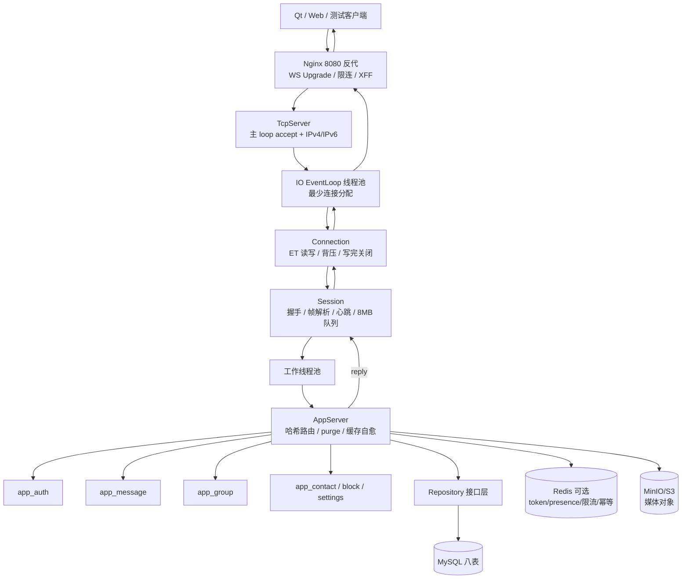

# IM 服务端架构说明（v3.3）

本文面向已经学习过 Reactor、希望深入 WebSocket、并发模型、存储分层和生产化实践的读者，按「架构事实 → 源码定位 → 关键机制 → 已知边界」组织。

> **文档基准：** `HEAD` 为 `0a78003`（2026-10-03），协议版本以 `docs/protocol.md`（v3.3）为准。本文描述当前代码事实；目录中的 `docs/docs/` 是已被 `.gitignore` 忽略的 v2.4 快照，请忽略。根 `README.md` 的口径略旧（见第 16 节漂移清单）。

## 1. 项目定位

单进程、C++17、Linux `epoll` ET 的 WebSocket IM 服务端。当前版本已从早期的「纯内存学习版」演进为：

- 手写 Reactor 网络层与 RFC 6455 协议栈。
- MySQL 八表持久化（用户、消息、联系人、好友请求、群、群成员、拉黑、媒体）。
- Redis 可选双后端（token、在线状态、限流、幂等）。
- MinIO/S3 对象存储预签名直传（图片消息）。
- Docker Compose 五件套部署（mysql + redis + minio + imserver + nginx）。

功能演进线（协议版本史）：

```text
v0.1 单聊
  -> v1.5 消息持久化 / 离线 / 历史 / 已读
  -> v1.8 联系人体系 + 隐私设置
  -> v1.9 群聊（单行存储 + 水位线）
  -> v2.0 群管理闭环
  -> v2.1 Presence 上 Redis
  -> v2.2 多端一致性
  -> v2.3 优雅停机 + 路由/分配/缓存自愈 + MySQL 断线自愈
  -> v2.4 拉黑
  -> v3.0 媒体对象存储直传
  -> v3.1 消息撤回
  -> v3.2 会话列表
  -> v3.3 可靠投递确认制（双 ACK）
```

明确非目标（截至 v3.3）：

- 多实例水平扩展与消息队列。
- 消息漫游与跨端已读。
- TLS 网关（`docs/nginx-deploy.md` 提供方案 B 模板，当前 compose 为 8080 明文入口）。
- 群已读（协议中 `unreadCount` 为占位恒 0）。

## 2. 目录与模块地图

| 分组 | 文件 | 职责 |
|---|---|---|
| 启动与配置 | `main.cpp`、`server_config.hpp`、`log.hpp` | 参数/环境变量、全部资源预算、日志 |
| Reactor | `eventloop.*`、`channel.*`、`eventloop_thread*.*` | epoll ET、eventfd、timerfd、IO 线程池 |
| TCP | `tcpserver.*`、`connection.*` | 双栈监听、连接分配、读写、背压、优雅关闭 |
| WebSocket | `websocket.*`、`session.*` | 握手、三态帧解析、分片、控制帧、心跳、业务队列 |
| 协议信封 | `message.*` | JSON envelope、error / result 构造 |
| 业务组合 | `appserver.*` | 装配、路由表、purge、缓存自愈、媒体 handler |
| 业务域 | `app_auth.cpp`、`app_message.cpp`、`app_contact.cpp`、`app_group.cpp`、`app_block.cpp`、`app_settings.cpp`、`app_util.hpp` | 各业务指令实现 |
| 用户与认证 | `user_store.*`、`user_repository.hpp`、`mysql_user_repository.*`、`token_store.*`、`redis_token_store.*` | PBKDF2、登录限流、token 摘要 |
| 消息存储 | `message_repository.hpp`、`mysql_message_repository.*` | 消息状态机、投递游标、撤回、可达性 |
| 联系人与群 | `contact_repository.*`、`group_repository.*`、`block_repository.*` | 联系人/请求/群/成员/拉黑 |
| 在线与限流 | `online_manager.*`、`presence_store.hpp`、`redis_presence_store.*`、`rate_limiter_store.*`、`redis_rate_limiter.*`、`msg_dedup.*`、`redis_msg_dedup.*` | 在线路由、各类限流、幂等 |
| MySQL 底座 | `mysql_client.*` | RAII、prepared statement、断线自愈 |
| Redis 底座 | `redis_client.*` | 连接、超时、断线重建 |
| 媒体 | `media_service.*`、`media_repository.hpp`、`mysql_media_repository.*`、`object_store.hpp`、`minio_object_store.*`、`sigv4.*`、`media_store.*` | 预签名直传、HEAD 校验、S3 SigV4、本地盘遗留 |
| 可观测 | `metrics.*` | 全局原子计数器与 `/health` |
| 工具 | `util.*` | socket 选项、SHA-1/SHA-256/HMAC/PBKDF2/Base64 |
| 测试与脚本 | `tests/`、`scripts/`、`db/` | 13 个 CTest、业务回归、压测、schema 与迁移 |

## 3. 总体架构



核心分层原则：

- 网络层（`TcpServer`）不含业务逻辑，通过回调把新连接交给业务层。
- 业务层（`AppServer`）持有工作线程池与全部存储，负责协议路由和编排。
- 存储通过 Repository 接口隔离，MySQL 为持久化实现，Redis 为可选加速/共享实现。

## 4. 线程模型

| 线程 | 数量 | 职责 |
|---|---:|---|
| 主线程 | 1 | 运行 accept 主 loop；`run()` 阻塞 |
| IO 线程 | N（默认 3） | 每线程一个 `EventLoop`：连接读写、心跳、握手超时、flush |
| 工作线程 | M（默认 5） | WebSocket 解析、JSON、鉴权、路由、DB/Redis 访问 |
| purge 线程 | 1 | 离线 TTL 清理、历史保留期清理、媒体 GC、缓存自愈比对 |

关键机制：

1. **新连接分配**：由早期的 `fd % N` 改为**最少连接优先**。`TcpServer` 维护每个 IO loop 的原子连接计数，`pickLeastLoadedIndex()` 选负载最小者（纯函数，可单测）。见 `src/tcpserver.hpp:67-78`、`src/tcpserver.cpp`。
2. **Session 串行化**：IO 线程只把原始 TCP 字节移入 `Session::pendingData_`；同一 Session 同时最多只有一个 `drain()` 在工作线程运行，保证连接内有序、连接间并行。见 `src/session.cpp` 的 `enqueueAndDrain()` / `drain()`。
3. **跨线程回复**：工作线程 `Session::reply()` → `Connection::send()` 入写队列 → `eventfd` 唤醒所属 IO loop → `flushWrite()` 非阻塞发送。
4. **Redis 锁外执行**：Redis 调用带 1 秒超时，且在业务锁之外执行，Redis 宕机不阻塞消息收发。

## 5. 启动与优雅停机

### 5.1 启动

```text
imserver [端口] [IO线程数] [工作线程数] [最大连接数] [允许Origin列表]
```

默认端口 9191、IO 线程 3、工作线程 5、连接数 0（不限）。

主要环境变量：

| 变量 | 作用 |
|---|---|
| `IM_MYSQL_HOST/PORT/USER/PASSWORD/DB` | MySQL 连接（必需，连接失败启动报错） |
| `IM_REDIS_ENABLED/HOST/PORT/PASSWORD/DB` | Redis 可选后端 |
| `IM_MAX_PER_IP_CONN` | 单 IP 并发连接上限（缺省 100） |
| `IM_TRUSTED_PROXIES` | 可信代理 IP 列表，决定是否信任 `X-Forwarded-For` |
| `IM_DELIVERY_ACK_REQUIRED` | 投递确认制开关（`1` = on） |
| `IM_OFFLINE_PURGE_INTERVAL` / `IM_MSG_RETENTION_DAYS` | 清理周期与保留期 |
| `IM_S3_ENDPOINT/REGION/BUCKET/ACCESS_KEY/SECRET_KEY/PATH_STYLE` | 对象存储（缺失则媒体降级 503） |
| `IM_MEDIA_GC_INTERVAL_SEC`、`IM_REGISTER_LIMIT_PER_WINDOW` | 媒体 GC、注册限流覆盖 |
| `IM_LOG_FILE/LEVEL/ROTATE_BYTES/KEEP` | 日志 |

启动顺序：解析参数与环境变量 → `Log::init()` → 构造 `AppServer`（连接 MySQL、可选 Redis、装配对象存储）→ `workPool_.start()` → `TcpServer::start()`（IO loop 就绪、双栈监听）→ 主线程 `run()`。

### 5.2 停机四步

```text
SIGINT / SIGTERM
  -> 信号处理器只做 requestStop（置位 + eventfd 唤醒）
  -> 主 loop 退出
  -> AppServer::stop()
       1. 停止接入（主 loop 已停）
       2. gracefulShutdown：向在线连接发 WS Close(1001 Going Away)，barrier 等待各 IO loop 处理完
       3. workPool_.stop()：排空已入队业务任务（5 秒超时后放弃）
       4. tcpServer_->stop()：兜底关闭全部连接并停止 IO loop
  -> main 15 秒看门狗兜底硬退（compose restart 依赖进程退出）
```

见 `src/main.cpp:176-193`、`src/appserver.cpp` 的 `stop()`、`src/tcpserver.cpp` 的 `requestStop/gracefulShutdown/stop`。

学习点：

- 信号处理器只能做 async-signal-safe 操作。
- 关闭连接前必须保证所属 EventLoop 仍在运行，barrier 解决停止竞态。
- 排水超时与看门狗保证停机有确定上界。

## 6. 网络核心

### 6.1 EventLoop 与 Channel

- `epoll` ET + `eventfd`（跨线程唤醒）+ `timerfd`（100ms 基础扫描的定时器系统）。
- 事件分发按 fd 查活跃表，避免同批事件中前序回调销毁 channel 造成 UAF。
- `runInLoop()`/`postToLoop()` 线程安全投递；`addPendingFlush()` 驱动写回。
- 定时器：`addTimer/cancelTimer`，心跳、握手超时、关闭 deadline 都基于它。

见 `src/eventloop.*`、`src/channel.*`。

### 6.2 TcpServer

- IPv4 与 IPv6 双监听（`Listenter` 两个 fd，`IPV6_V6ONLY` 区分）。
- 总连接上限与单 IP 并发上限（`perIpCounts_`，连接释放时凭 `connIp_` 扣减）。
- accept 循环到 `EAGAIN`（ET），设置 `TCP_NODELAY`、非阻塞。
- 最少连接分配 + 每 loop 原子计数。
- 三段停机：`requestStop` → `gracefulShutdown` → `stop`。

### 6.3 Connection

- ET 读：循环 `recv` 到 `EAGAIN`；单次读事件累计上限 `kMaxMessageBytes + 64KB`（`static_assert` 保证能容纳最大合法消息，防止大图被误判洪泛）。
- 写：`SendResult` 三态（`Ok/Closed/Overflow`），不再静默丢弃；写缓冲 8MB 上限，超限标记待断开。
- 原子字节计数 `writeBufferedBytes_` 跨线程判断背压；`writeQueue_` 由 `writeMutex_` 保护。
- `shutdownAfterFlush()`：写完剩余缓冲再关闭，带 5 秒 deadline（`kCloseFlushDeadline`）。
- 对端 IP 注入（`peerIp_`）供真实 IP 判定。

见 `src/connection.hpp:43-95`、`src/connection.cpp`。

## 7. WebSocket 协议栈

### 7.1 握手

要求（v1.4 起严格化）：

- 请求行 `GET / HTTP/1.1`。
- 必须有 `Host`。
- `Upgrade: websocket`、`Connection: Upgrade`（多 Token、大小写不敏感）。
- `Sec-WebSocket-Version: 13`。
- `Sec-WebSocket-Key` 必须是合法 Base64 且解码 16 字节。
- Header 名大小写不敏感。
- 可选 Origin/Host 白名单（启动参数）。
- 连接建立后 10 秒未完成握手断开（防 Slowloris）。

Accept 计算：

```text
Sec-WebSocket-Accept
  = Base64(SHA1(Sec-WebSocket-Key + Magic GUID))

Magic GUID = 258EAFA5-E914-47DA-95CA-C5AB0DC85B11
```

这里的 SHA-1 是协议规定的握手计算，不是密码存储算法。可信代理场景下 `X-Forwarded-For` 首段作为真实 IP（仅对端在 `IM_TRUSTED_PROXIES` 内时信任）。

### 7.2 帧结构

一个 WebSocket 帧由固定头、可选扩展长度、可选掩码和 payload 组成：

```text
第 1 字节：
+-----+-----+-----+-----+----------+
| FIN |RSV1 |RSV2 |RSV3 |  OPCODE  |
+-----+-----+-----+-----+----------+

第 2 字节：
+------+-------------------+
| MASK | Payload Length    |
+------+-------------------+

后续可能有：
Extended Payload Length（2 或 8 字节，网络字节序）
Masking Key（4 字节）
Payload
```

| 字段 | 作用 |
|---|---|
| FIN | 是否为逻辑消息的最后一帧 |
| RSV1~RSV3 | 扩展保留位，未启用扩展时必须为 0 |
| OPCODE | Text(0x1)、Binary(0x2)、Continuation(0x0)、Close(0x8)、Ping(0x9)、Pong(0xA) |
| MASK | 客户端帧必须为 1，服务端帧为 0 |
| Payload Length | 见下表 |

| 基础长度值 | 编码方式 |
|---:|---|
| 0 到 125 | 长度直接写在第二字节低 7 位 |
| 126 | 后续 2 字节表示 16 位网络字节序长度 |
| 127 | 后续 8 字节表示 64 位网络字节序长度 |

掩码解码：

```text
payload[i] = encoded[i] XOR maskKey[i % 4]
```

掩码用于防止中间代理用固定模式推断内容，属于协议强制要求，不是加密。客户端到服务端必须掩码，服务端到客户端不掩码，见 `buildFrame()`。

### 7.3 帧解析：三态结果

```cpp
enum class ParseResult {
  NeedMore,        // 数据不足，等待更多
  Complete,        // 解析出一个完整帧
  ProtocolError,   // RFC 6455 违规，应断开
};
```

解析时执行严格校验：

- RSV 位必须为 0。
- opcode 合法性。
- 客户端帧必须 MASK（未掩码即协议错误）。
- 最小长度编码（禁止用 126/127 编码短 payload）。
- 单帧上限 `kMaxFrameBytes`（64MB）。
- 控制帧必须 FIN 且 payload ≤ 125 字节。
- Close payload 的 UTF-8 与 Close code 合法性。
- `isValidUtf8()` / `isValidCloseCode()` 独立可单测。

增量解析使用 `buf_ + pos_` 游标：`parseOne()` 只在数据足够时前移游标，不立即删除已解析字节；当 `pos_` 超过 4096 字节或超过缓冲一半时才执行一次 `compact()`，把成本摊还到 O(1)，避免每帧从字符串头部删除造成 O(n²)。

### 7.4 分片与控制帧

- Text/Binary 起始帧 + Continuation 重组，累积上限 2MB；分片未完成又来新数据帧即断开。
- Ping 自动回 Pong；Close 回 Close 后走写完关闭。
- 文本消息交给业务层；二进制只记录大小。

### 7.5 心跳与超时

- 每 30 秒发 Ping；60 秒无任何数据判僵尸断开。
- 握手 10 秒截止；关闭 flush 5 秒 deadline。
- 三者都由 `EventLoop` 的 `timerfd` 定时器驱动。

### 7.6 /health

HTTP GET `/health`（非 WebSocket）在握手前短路应答，返回指标 JSON 后关闭连接：

```json
{ "status": "ok",
  "activeConnections": 0, "connectionsAccepted": 0, "connectionsClosed": 0,
  "handshakeFailures": 0, "protocolErrors": 0, "authFailures": 0,
  "rateLimited": 0, "messagesDelivered": 0, "messagesOffline": 0,
  "writeOverflows": 0 }
```

## 8. Session

Session 状态可抽象为：

```text
TCP_CONNECTED
  -> HTTP_HANDSHAKE（10s deadline）
  -> WEBSOCKET_CONNECTED（未登录）
  -> LOGGED_IN
  -> CLOSING（写完关闭 / 协议错误）
  -> CLOSED
```

要点：

- `guard_` 自持 + Connection 回调持 `weak_ptr<Session>`，打破循环引用。
- 读方向队列 8MB，超限断开洪泛连接。
- `userId_` 为原子变量（工作线程写、loop 线程读）。
- 关闭时取消心跳/握手定时器、通知 AppServer 摘除在线表、释放 `guard_`。

见 `src/session.hpp:80-124`、`src/session.cpp`。

## 9. 业务组合层

### 9.1 路由

`AppServer` 持有：

```cpp
using Handler = void (AppServer::*)(const std::shared_ptr<Session>&, const json&);
std::unordered_map<std::string, Handler> routes_;
```

构造时 `buildRoutes()` 一次性注册。分发 `onEnvelope()`：先做未登录门禁（只放行 `auth.register/login/token`），再 O(1) 查表；未知指令 400；`json::exception` 统一收口 400。

当前注册约 38 条指令（`appserver.cpp` 文件头注释写 35，属已确认的注释漂移）。

### 9.2 域文件拆分

路由函数按业务域拆到独立 `.cpp`，成员仍属于 `AppServer` 类：

| 文件 | 域 |
|---|---|
| `app_auth.cpp` | `auth.register/login/token/logout`、离线补发入口 |
| `app_message.cpp` | `msg.send/offline_ack/history/read/recall`、`chat.*`、`conversation.list`、图片预检 |
| `app_contact.cpp` | `user.search`、`contact.*` |
| `app_group.cpp` | `group.*` 全生命周期与群发、群 ACK |
| `app_block.cpp` | `block.add/remove/list` |
| `app_settings.cpp` | `settings.get/set` |
| `app_util.hpp` | 账号/密码校验、目标解析（header-only） |

### 9.3 装配与后台

- 构造初始化列表装配 `UserStore`、`MessageRepository`、`ContactRepository`、`GroupRepository`、`BlockRepository`、Presence、四个限流器、`MediaService` 等。
- `make*Store` 工厂按 Redis 是否启用在内存/Redis 双后端间选择；Redis 连接失败启动即抛错。
- `purgeLoop()`：周期执行离线 TTL 清理、历史保留期清理、媒体 GC、缓存自愈比对。
- `syncCaches()`：联系人/群成员/拉黑/用户四类缓存与库计数比对，漂移则全量重建（防绕过服务端直改库）。

## 10. 存储与中间件

### 10.1 Repository 接口

| 接口 | 实现 | 后端 |
|---|---|---|
| `UserRepository` | `MySqlUserRepository` | MySQL |
| `MessageRepository` | `MySqlMessageRepository` | MySQL |
| `MediaRepository` | `MySqlMediaRepository` | MySQL |
| `ContactRepository` / `GroupRepository` / `BlockRepository` | 具体类（同构仓储） | MySQL |
| `TokenStore` | `MemoryTokenStore` / `RedisTokenStore` | 内存 / Redis |
| `PresenceStore` | `MemoryPresenceStore` / `RedisPresenceStore` | 内存 / Redis |
| `RateLimiterStore` | `MemoryRateLimiter` / `RedisRateLimiter` | 内存 / Redis |
| `MsgDedupStore` | `MemoryMsgDedup` / `RedisMsgDedup` | 内存 / Redis |
| `ObjectStore` | `MinioObjectStore` | MinIO/S3 |

门面：`UserStore` 组合 `UserRepository + TokenStore`；`OnlineManager` 组合 `PresenceStore`。

### 10.2 MySQL 八表

`db/schema.sql`：

| 表 | 关键内容 |
|---|---|
| `users` | account 唯一、username 昵称、salt、password_hash（PBKDF2）、隐私三开关 |
| `messages` | `id` 自增（内部游标）、`message_id` 唯一（对外）、from/to、content、ts、client_msg_id、chat_type、msg_type、media_id、group_id（0=单聊）、status、delivered_ts、read_ts、recalled_ts |
| `contacts` | 双向各一行 |
| `friend_requests` | 状态机 0/1/2 |
| `groups` | name、owner、announcement、dissolved |
| `group_members` | `last_delivered_ts`/`last_delivered_id` 投递游标、left_ts |
| `blocks` | 单向拉黑 |
| `media` | file_id、object_key、status（0 PENDING / 1 UPLOADED / 2 COMMITTED / 3 GC） |

消息状态：`0 PENDING / 1 DELIVERED / 2 READ / 3 RECALLED`。

全部 SQL 使用 prepared statement；`MySqlClient` 对 errno 2006/2013/4031 自动重建连接并重试一次；读写超时 5 秒。

### 10.3 Redis 键设计

| 用途 | 键 | 操作 |
|---|---|---|
| token | `<sha256 摘要>`（无前缀） | `SETEX/GET/DEL`，只存摘要 |
| Presence | `p:online:<userId>` | `INCR + EXPIRE` / `DECR` / `EXISTS` / 批量 `MGET` |
| 发送限流 | `rate:<userId>` | ZSET 滑窗 |
| 查询限流 | `qrate:<userId>` | ZSET 滑窗 |
| 注册限流 | `reg:<ipHash>` | ZSET 滑窗 |
| 媒体限流 | `mrate:<userId>` | ZSET 滑窗 |
| 幂等 | `dedup:<userId>:<clientMsgId>` | `SET NX EX 300` / `EXISTS` |

限流器在 Redis 不可用时 fail-closed；token/在线状态在 Redis 宕机时降级（免密重连与在线显示受影响，消息收发不受影响）。

## 11. 业务功能链路

### 11.1 单聊发送（`msg.send`）全链路

```text
[IO 线程] recv -> Session 队列
[工作线程] 解析 -> 路由 -> AppServer::onSend
  1. clientMsgId 长度校验
  2. chatType / msgType 校验（image 走媒体归属与 COMMITTED 校验）
  3. 幂等查询（命中直接 ack，不耗配额）
  4. 目标解析（account）/ 内容长度 / 发送限流
  5. 拉黑、联系人、临时对话权限
  6. 拉黑/权限通过后落库：
     status = (ackRequired || 目标不在线) ? PENDING : DELIVERED
     saveMessage 先落库（失败 500，不记幂等）
  7. remember 幂等 -> msg.ack 携带 messageId
  8. 在线：推送 msg.recv；离线：留在 MySQL 待补发
  9. 自发消息回显到发送者其他在线端
[IO 线程] reply -> 写队列 -> flushWrite
```

### 11.2 群聊与连续前缀 ACK

- 群消息**单行存储**：`to_user=0, group_id=G`，每成员靠 `group_members` 水位线补发（写少读可控）。
- 群管理：建群/拉人/踢人/退群/转让/解散/改名/公告，成员上限 50，`addMemberCapped` 原子防超员。
- `group.offline_ack{groupId, messageIds[]}`：语义为「从当前游标起的连续可交付前缀」。服务端按 `(ts,id)` 升序取流，自身消息与已撤回直接越过不阻塞，遇到未确认的可交付消息即停止，只推进到连续前缀最远端。
- `advanceDeliveredCursor` SQL 严格只进；游标为**用户级**（非设备级）。
- 群聊天记录由所有现成员共享可见，`untilTs=left_ts` 过滤退群后消息。

### 11.3 联系人与拉黑

- 好友请求状态机：request / accept（互相请求自动关闭反向）/ reject / list / requests / delete。
- 隐私三开关：`allowTempChat`、`searchable`、`allowAdd`。
- 列表恒含自己（注册时写入）。
- 拉黑为**双向断联**：双方单聊 403（分方向文案）、好友请求拒绝（被拉黑方文案模糊防探测）、自动删除联系人；群聊不受影响；不追溯历史消息；无 S2C 推送。

### 11.4 媒体（对象存储直传）

```text
1. media.presign -> 校验 kind/mime/size -> 生成 fileId 与 objectKey
   -> 落 PENDING -> 返回预签名 PUT（900s）
2. 客户端直传 MinIO/S3（服务端不中转）
3. media.commit -> 归属校验 -> HEAD 校验存在/大小
   -> PENDING -> COMMITTED，写入以 HEAD 为准的元数据
4. msg.send(msgType=image, mediaId=fileId)
5. media.url -> hasMediaAccess 鉴权 -> 批量签发 GET（3600s）
6. GC：PENDING 超 24h -> CAS 置 GC -> 删除对象
```

约束：单文件 ≤ 20MB；presign 30 次/分钟；`media.url` 单次批量 ≤ 100；未装配对象存储时媒体接口回 503，消息收发不受影响。SigV4 为纯函数实现（可单测）。

### 11.5 撤回与会话列表

- 撤回：单条 UPDATE 原子校验（存在 + 发送者 + 120 秒窗 + 状态迁移到 3），失败回查分类；出站序列化统一剥离正文与媒体并置 `recalled:true`；已撤回图片 `media.url` 拒绝。
- 会话列表：派生式实现（无物化表）。单聊未读来自 `messages.status` 聚合，按 `lastMsgTs` 倒序，末条用有界点查；群条目按 `last_delivered_ts` 排序，群未读 v3.2 恒 0（占位）。

## 12. 可靠投递语义（v3.3）

### 12.1 ID 体系

| ID | 用途 |
|---|---|
| `messages.id`（`StoredMessage.id`） | 内部自增主键，投递游标的 id 分量，**不对客户端暴露** |
| `messageId` | 对外全局 ID：`<unix 秒>-<进程内自增>`，序列起点随机化防重启同秒碰撞 |
| `clientMsgId` | 客户端生成，幂等去重 |

### 12.2 双 ACK 与开关

`IM_DELIVERY_ACK_REQUIRED` 默认 `off`：

| 模式 | 单聊 | 群聊 |
|---|---|---|
| off（阶段 A） | 在线即 DELIVERED；ACK 仅接收 | 推送/补发推进水位线 |
| on（阶段 B） | 落库恒 PENDING，仅 `msg.offline_ack` 驱动 `0→1` | 仅 `group.offline_ack` 驱动游标 |

禁止单聊/群聊分开灰度（群游标为用户级，混合设备会漏收）。

### 12.3 语义边界

```text
服务端已发送 ≠ 客户端已确认收到 ≠ 已读
```

- `msg.ack` 表示服务端已接受并落库，携带 `messageId`。
- 确认制为 **at-least-once**：客户端需按 `messageId` 去重。
- ACK 丢失时下次登录补发；补发非破坏性（未确认会再发）。
- 离线 TTL 7 天清理未领取；已消费历史保留 90 天。

## 13. 可观测性与工程

- **日志**：`log.hpp` 自研，级别 + 文件/行号 + 线程 id，固定 UTC+8，按大小轮转（`IM_LOG_*`）。
- **指标**：`metrics.hpp` 全局原子计数（accept/close/active、握手失败、协议错误、认证失败、限流、pushed、delivered、offline、writeOverflow）；`/health` 输出。
- **pushed 与 delivered 拆分**：pushed 只代表已写入连接，delivered 由 ACK 驱动。
- **构建基线**：`-Wall -Wextra` 零警告；`IM_SANITIZE`（ASan/UBSan/LSan）与 `IM_TSAN` 选项。
- **测试**：13 个 CTest 单测（解析器、握手、幂等、限流、日志、目标解析、登录保护、TcpServer、线程池、媒体、密码学、SigV4、MinIO）；`scripts/biz_test.py` 真 WebSocket 全链路回归（双后端各跑一遍）；`scripts/bench.py` 压测（2000 连接 / 吞吐 / RSS）。
- **CI**：`scripts/ci.sh`（构建 + ctest + 内存模式 + Redis 模式；`--full` 加 ASan 并断言日志零 sanitizer 报告）；`.github/workflows/ci.yml` 等价流水线。

## 14. 部署

```text
docker compose up -d --build
  = mysql 8.4 + redis 8 + minio + createbuckets + nginx + imserver
```

- `imserver` 仅绑 `127.0.0.1:9191`，对外唯一入口为 Nginx 8080（WS Upgrade、`limit_conn`、XFF 透传）。
- 首次启动自动导入 `db/schema.sql`；存量库按需执行 `db/migrate_*.sql`（幂等）。
- 健康检查 `/health`；`restart: unless-stopped`；`stop_grace_period: 20s`。
- 本地开发用 `compose.dev.yaml`（只起依赖，服务本机跑）；`scripts/db_env.sh` 读取 `.env.local` 凭据。
- 部署细节见 `docs/nginx-deploy.md` 与协议文档 §10。

## 15. 当前边界与已知漂移

已知且值得留意的文档/注释漂移：

| 位置 | 问题 |
|---|---|
| 根 `README.md` | 代码规模写 ~7600 行/47 文件，实际 src 约 12000 行/83 文件；快速开始引用 `.env.example`，仓库不存在该文件；文档索引写协议 v3.0，实际 v3.3 |
| `src/appserver.cpp` 文件头 | 注释写「35 条指令」，实际路由约 38 条 |
| `docs/client_design.md` | 头部标 v2.2，落后于协议 v3.3 |
| `docs/docs/` | v2.4 过期快照，已被 `.gitignore` 忽略，勿读 |
| `src/media_store.*` | base64 本地盘管线遗留，仅单测使用 |

架构层面的已知边界：

- 单进程（Presence 与限流状态在多实例下不共享）。
- 无消息队列与跨实例路由。
- 群已读未实现（占位字段）。
- `msg.recv` 等推送免 ACK（丢失靠重登补发与历史拉取自愈）。

## 16. 推荐源码阅读顺序

按依赖排序，适合从网络到业务、从存储到可靠性逐步深入：

1. `src/server_config.hpp` — 全部预算与开关（尤其 `deliveryAckRequired()`）。
2. `src/main.cpp` + `src/log.hpp` — 启动、环境变量、停机四步与看门狗。
3. `src/eventloop.*` + `src/channel.*` — epoll ET、eventfd、timerfd、UAF 防护。
4. `src/eventloop_thread*.*` + `src/threadpool.*` — 两类线程池与停机排水。
5. `src/tcpserver.*` — 双栈、限流、最少连接分配、三段停机。
6. `src/connection.*` — ET 读写、背压、`SendResult`、写完关闭。
7. `src/websocket.*` — 握手与三态帧解析；`src/session.*` — 状态机与串行队列。
8. `src/message.*` + `src/appserver.*`（路由表、装配、purge、syncCaches）。
9. `src/app_util.hpp` + `src/app_auth.cpp` — 校验与认证、离线补发入口。
10. `src/message_repository.hpp` + `src/mysql_message_repository.cpp` — 状态机与游标事实源。
11. `src/app_message.cpp` — 单聊可靠投递全链路；`src/app_group.cpp` — 群与连续前缀 ACK。
12. `src/contact_repository.*`、`src/group_repository.*`、`src/block_repository.*` 及对应 `app_*.cpp`。
13. `src/media_service.*`、`src/object_store.hpp`、`src/sigv4.*`、`src/minio_object_store.*`。
14. `db/schema.sql` + `docs/protocol.md`（v3.3）收口。

## 17. 快速自测题

1. 新连接为什么改为最少连接分配？与 `fd % N` 相比解决什么问题？
2. 一次 `recv()` 为什么不能等价于一条 WebSocket 消息？三态解析解决了什么？
3. 握手超时、心跳、关闭 deadline 分别由什么驱动？
4. `SendResult` 三态与 8MB 写缓冲如何配合实现背压？
5. 为什么 WebSocket 解析放在工作线程而不是 IO 线程？同 Session 如何保序？
6. `messages.id` 与 `messageId` 分别用于什么？为什么需要两个 ID？
7. 确认制 on 模式下，单聊消息从 PENDING 到 DELIVERED 的完整路径是什么？
8. 群 ACK 为什么必须推进「连续前缀」而不能取最大 `(ts,id)`？
9. Redis 宕机时哪些能力降级、哪些不受影响？
10. 优雅停机四步分别解决什么问题？看门狗的作用是什么？
